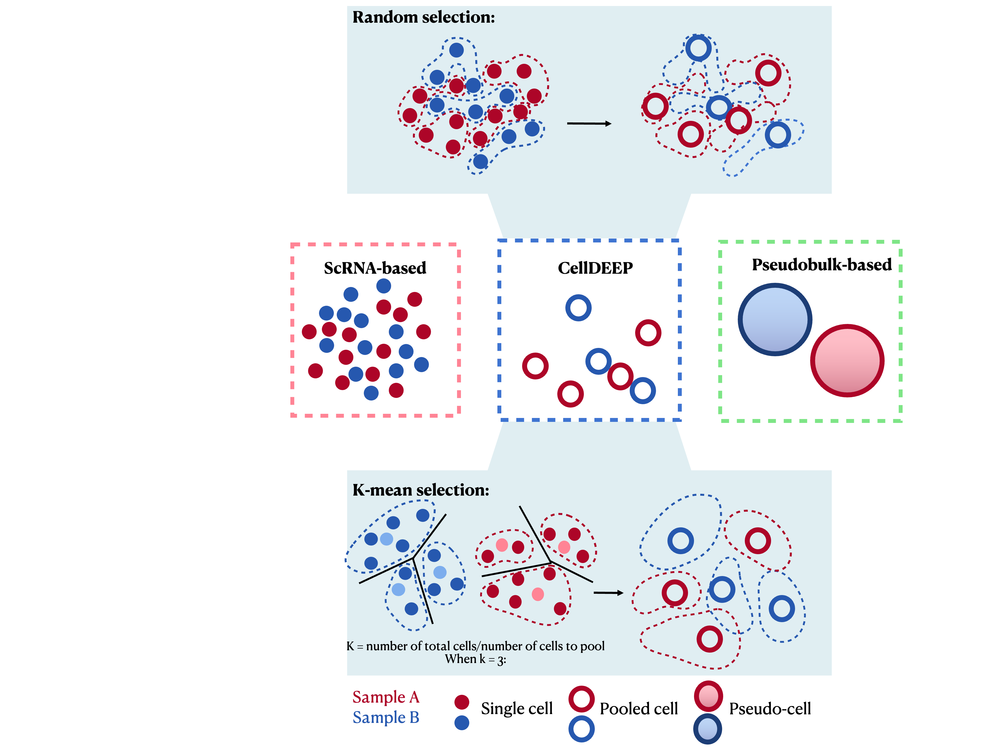

<!-- README.md is generated from README.Rmd. Please edit that file -->

# CellDEEP

<!-- badges: start -->

<!-- badges: end -->

## Introduction to CellDEEP

Single-cell RNA sequencing (scRNA-seq) allows us to explore gene
expression at an unprecedented resolution, but it faces significant
challenges like high dropout rates and data sparsity. CellDEEP was
developed to bridge the gap between robust but coarse pseudobulk methods
and sensitive but potentially biased single-cell methods.

<figure>

<figcaption aria-hidden="true">CellDEEP overview</figcaption>
</figure>

Check our paper for details:
<https://gla-my.sharepoint.com/:w:/g/personal/domenico_somma_glasgow_ac_uk/IQClckLR7tE6SLF5Raw7J39PAWbMgDQf-qdc73jdZYNDUHE?e=j0le0G>

## Installation

You can install the CellDEEP from CRAN:

``` r
install.packages("CellDEEP")
```

## Example

Before using, don’t forget library it:

``` r
library(CellDEEP)
```

### Vignette:

- [Tutorial
  vignette](https://sii-scrna-seq.github.io/CellDEEP/articles/CellDEEP_vignette.html)

To quickly run CellDEEP, pass your metadata column names directly into
`FindMarker.CellDEEP`:

``` r
data("sim")

# Pool defaults to TRUE
de.test <- FindMarker.CellDEEP(sim, 
                          group_id = "Status", 
                          sample_id = "DonorID", 
                          cluster_id = "cluster_id",
                          Pool = TRUE,
                          test.use = "wilcox", 
                          n_cells = 3, 
                          min_cells_per_subgroup = 1,
                          cell_selection = "random", 
                          readcounts = "sum", 
                          logfc.threshold = 0.25, 
                          ident.1 = "Case", 
                          ident.2 = "Control")

de.test
```

The output here would be a gene list. If you want the whole DE output
list include p-value and logFC, simply change the parameter `name_only`
to FALSE:

``` r
de.test <- FindMarker.CellDEEP(sim, 
                          group_id = "Status", 
                          sample_id = "DonorID", 
                          cluster_id = "cluster_id",
                          Pool = TRUE,
                          test.use = "wilcox", 
                          n_cells = 3, 
                          min_cells_per_subgroup = 1,
                          cell_selection = "random", 
                          readcounts = "sum", 
                          logfc.threshold = 0.25, 
                          ident.1 = "Case", 
                          ident.2 = "Control",
                          name.only = FALSE)
#> Start Pooling.....
#> Pooling...
#> Warning: Data is of class matrix. Coercing to dgCMatrix.
#> Pooling summary (random):
#> Input cells: 200
#> Cells kept in pooled pseudocells: 180
#> Cells not kept (approx): 20
#> Skipped empty groups: 0
#> Skipped empty clusters: 0
#> Skipped empty samples: 20
#> Skipped subgroups (<= min_cells_per_subgroup): 0
#> Dropped remainder cells (< n_cells) after random pooling: 20
#> FindMarker running.....
#> 1st ident is:
#> Case
#> 2nd ident is:
#> Control
#> group by:
#> group_id
#> Normalizing layer: counts
#> Finding variable features for layer counts
#> Centering and scaling data matrix
#> For a (much!) faster implementation of the Wilcoxon Rank Sum Test,
#> (default method for FindMarkers) please install the presto package
#> --------------------------------------------
#> install.packages('devtools')
#> devtools::install_github('immunogenomics/presto')
#> --------------------------------------------
#> After installation of presto, Seurat will automatically use the more 
#> efficient implementation (no further action necessary).
#> This message will be shown once per session

de.test
#>                 p_val avg_log2FC pct.1 pct.2    p_val_adj
#> Gene1728 2.398196e-11   3.493846 1.000 0.567 4.796393e-08
#> Gene1992 5.772013e-11 -11.401061 0.000 0.900 1.154403e-07
#> Gene1626 8.774766e-11  -3.879532 0.200 1.000 1.754953e-07
#> Gene1864 1.933222e-10 -10.188828 0.000 0.867 3.866443e-07
#> Gene1715 1.934584e-10  -9.855602 0.000 0.867 3.869168e-07
#> Gene1807 6.247026e-10  -9.667764 0.000 0.833 1.249405e-06
#> Gene1734 1.945739e-09 -10.442942 0.000 0.800 3.891477e-06
#> Gene1687 5.852156e-09  -9.281488 0.000 0.767 1.170431e-05
#> Gene1799 5.852156e-09  -9.530076 0.000 0.767 1.170431e-05
#> Gene1602 1.699523e-08  -9.564190 0.000 0.733 3.399046e-05
#> Gene1818 4.788409e-08  -9.701152 0.000 0.700 9.576818e-05
#> Gene1840 9.597780e-08  -2.380240 0.300 0.933 1.919556e-04
#> Gene1907 7.729886e-07  -4.303809 0.100 0.700 1.545977e-03
#> Gene1631 8.865827e-07  -9.169159 0.000 0.600 1.773165e-03
#> Gene1663 2.212951e-06  -9.681669 0.000 0.567 4.425903e-03
#> Gene1963 2.563218e-06  -2.807696 0.167 0.767 5.126437e-03
#> Gene1837 7.133840e-06   2.990443 0.767 0.400 1.426768e-02
#> Gene1644 1.171262e-05  -2.251728 0.233 0.833 2.342525e-02
#> Gene1906 1.271729e-05  -8.919825 0.000 0.500 2.543457e-02
#> Gene1845 2.279927e-05  -2.582287 0.133 0.700 4.559855e-02
```

And if you want full list without any filtering for analysis like GSEA,
simply set `full_list` to TRUE:

``` r
de.test.full <- FindMarker.CellDEEP(sim, 
                          group_id = "Status", 
                          sample_id = "DonorID", 
                          cluster_id = "cluster_id",
                          Pool = TRUE,
                          test.use = "wilcox", 
                          n_cells = 3, 
                          min_cells_per_subgroup = 1,
                          cell_selection = "random", 
                          readcounts = "sum", 
                          logfc.threshold = 0.25, 
                          ident.1 = "Case", 
                          ident.2 = "Control",
                          name.only = FALSE,
                          full_list = TRUE)
#> Start Pooling.....
#> Pooling...
#> Warning: Data is of class matrix. Coercing to dgCMatrix.
#> Pooling summary (random):
#> Input cells: 200
#> Cells kept in pooled pseudocells: 180
#> Cells not kept (approx): 20
#> Skipped empty groups: 0
#> Skipped empty clusters: 0
#> Skipped empty samples: 20
#> Skipped subgroups (<= min_cells_per_subgroup): 0
#> Dropped remainder cells (< n_cells) after random pooling: 20
#> FindMarker running.....
#> 1st ident is:
#> Case
#> 2nd ident is:
#> Control
#> group by:
#> group_id
#> Normalizing layer: counts
#> Finding variable features for layer counts
#> Centering and scaling data matrix

de.test.full
#>                 p_val  avg_log2FC pct.1 pct.2    p_val_adj
#> Gene1728 2.398196e-11   3.4938457 1.000 0.567 4.796393e-08
#> Gene1992 5.772013e-11 -11.4010605 0.000 0.900 1.154403e-07
#> Gene1626 8.774766e-11  -3.8795324 0.200 1.000 1.754953e-07
#> Gene1864 1.933222e-10 -10.1888276 0.000 0.867 3.866443e-07
#> Gene1715 1.934584e-10  -9.8556016 0.000 0.867 3.869168e-07
#> Gene1807 6.247026e-10  -9.6677640 0.000 0.833 1.249405e-06
#> Gene1734 1.945739e-09 -10.4429419 0.000 0.800 3.891477e-06
#> Gene1687 5.852156e-09  -9.2814883 0.000 0.767 1.170431e-05
#> Gene1799 5.852156e-09  -9.5300762 0.000 0.767 1.170431e-05
#> Gene1602 1.699523e-08  -9.5641902 0.000 0.733 3.399046e-05
#> Gene1818 4.788409e-08  -9.7011516 0.000 0.700 9.576818e-05
#> Gene1840 9.597780e-08  -2.3802404 0.300 0.933 1.919556e-04
#> Gene1907 7.729886e-07  -4.3038087 0.100 0.700 1.545977e-03
#> Gene1631 8.865827e-07  -9.1691588 0.000 0.600 1.773165e-03
#> Gene1663 2.212951e-06  -9.6816691 0.000 0.567 4.425903e-03
#> Gene1963 2.563218e-06  -2.8076957 0.167 0.767 5.126437e-03
#> Gene1837 7.133840e-06   2.9904429 0.767 0.400 1.426768e-02
#> Gene1644 1.171262e-05  -2.2517275 0.233 0.833 2.342525e-02
#> Gene1906 1.271729e-05  -8.9198250 0.000 0.500 2.543457e-02
#> Gene1845 2.279927e-05  -2.5822869 0.133 0.700 4.559855e-02
#> Gene1857 2.934287e-05  -8.4268531 0.000 0.467 5.868574e-02
#> Gene1941 3.081551e-05   3.1593333 0.700 0.333 6.163103e-02
#> Gene1767 6.606669e-05  -8.1415854 0.000 0.433 1.321334e-01
#> Gene1821 6.609642e-05  -9.1236630 0.000 0.433 1.321928e-01
#> Gene1995 6.609642e-05  -8.7987919 0.000 0.433 1.321928e-01
#> Gene1813 1.455166e-04  -8.9570235 0.000 0.400 2.910332e-01
#> Gene1865 1.455166e-04  -8.8992207 0.000 0.400 2.910332e-01
#> Gene1843 2.236469e-04  -2.2246419 0.167 0.667 4.472939e-01
#> Gene1949 3.030277e-04  -2.7530326 0.100 0.567 6.060555e-01
#> Gene307  4.173981e-04   0.8905032 0.967 0.800 8.347962e-01
#> Gene1956 5.629155e-04  -2.4034411 0.267 0.633 1.000000e+00
#> Gene1876 6.614019e-04  -7.8823623 0.000 0.333 1.000000e+00
#> Gene1674 6.616739e-04  -8.3316635 0.000 0.333 1.000000e+00
#> Gene1855 6.616739e-04  -8.5625017 0.000 0.333 1.000000e+00
#> Gene1919 6.616739e-04  -8.8574850 0.000 0.333 1.000000e+00
#> Gene1918 7.394840e-04  -3.8468440 0.033 0.400 1.000000e+00
#> Gene1586 1.118196e-03   4.4975940 0.367 0.033 1.000000e+00
#> Gene1897 1.281908e-03  -2.3239914 0.233 0.633 1.000000e+00
#> Gene1805 1.370186e-03  -9.5978685 0.000 0.300 1.000000e+00
#> Gene1211 1.598119e-03   0.9668215 0.833 0.500 1.000000e+00
#> Gene1827 1.665435e-03  -2.5378831 0.133 0.500 1.000000e+00
#> Gene1744 1.946029e-03  -1.6021933 0.133 0.567 1.000000e+00
#> Gene1723 2.058308e-03  -2.5162080 0.067 0.433 1.000000e+00
#> Gene1606 2.788006e-03  -7.2167083 0.000 0.267 1.000000e+00
#> Gene1612 2.788006e-03  -7.5105321 0.000 0.267 1.000000e+00
#> Gene1614 2.788006e-03  -8.0477340 0.000 0.267 1.000000e+00
#> Gene1757 2.788006e-03  -8.4921354 0.000 0.267 1.000000e+00
#> Gene1836 2.788006e-03  -7.8541152 0.000 0.267 1.000000e+00
#> Gene1891 2.788006e-03  -7.7477646 0.000 0.267 1.000000e+00
#> Gene1917 2.788006e-03  -7.9168357 0.000 0.267 1.000000e+00
#> Gene1965 2.788006e-03  -8.1811772 0.000 0.267 1.000000e+00
#> Gene1675 3.398260e-03  -2.2074601 0.133 0.500 1.000000e+00
#> Gene1850 4.249589e-03  -2.3992085 0.033 0.333 1.000000e+00
#> Gene1676 4.739841e-03  -4.0573068 0.033 0.300 1.000000e+00
#> Gene1273 5.584312e-03  -7.7285121 0.000 0.233 1.000000e+00
#> Gene1616 5.584312e-03  -7.1181448 0.000 0.233 1.000000e+00
#> Gene1673 5.584312e-03  -8.1054588 0.000 0.233 1.000000e+00
#> Gene1772 5.584312e-03  -7.9045153 0.000 0.233 1.000000e+00
#> Gene310  8.241903e-03   2.7736525 0.300 0.033 1.000000e+00
#> Gene371  8.963958e-03  -1.0565421 0.300 0.733 1.000000e+00
#> Gene1889 1.077124e-02  -2.5554422 0.067 0.333 1.000000e+00
#> Gene844  1.103509e-02  -7.4339444 0.000 0.200 1.000000e+00
#> Gene1658 1.103509e-02  -7.4573291 0.000 0.200 1.000000e+00
#> Gene1777 1.103509e-02  -7.2689234 0.000 0.200 1.000000e+00
#> Gene1844 1.103509e-02  -7.3767408 0.000 0.200 1.000000e+00
#> Gene1961 1.103509e-02  -7.6750228 0.000 0.200 1.000000e+00
#> Gene1991 1.103509e-02  -7.4927395 0.000 0.200 1.000000e+00
#> Gene225  1.142350e-02   1.5414179 0.533 0.267 1.000000e+00
#> Gene282  1.378550e-02   0.7123230 0.933 0.867 1.000000e+00
#> Gene1011 1.403089e-02   1.1414913 0.733 0.633 1.000000e+00
#> Gene1989 1.451643e-02  -2.3241865 0.067 0.333 1.000000e+00
#> Gene1726 1.548420e-02  -3.6857791 0.067 0.300 1.000000e+00
#> Gene1198 1.606299e-02   1.6307160 0.433 0.167 1.000000e+00
#> Gene1179 1.695653e-02   0.9545090 0.767 0.533 1.000000e+00
#> Gene1435 1.737835e-02   0.9063891 0.667 0.400 1.000000e+00
#> Gene1520 1.901909e-02   0.6823681 0.933 0.833 1.000000e+00
#> Gene1812 1.961764e-02  -1.6511625 0.100 0.367 1.000000e+00
#> Gene1580 2.033929e-02   2.2404857 0.433 0.200 1.000000e+00
#> Gene93   2.068767e-02  -1.4335036 0.100 0.367 1.000000e+00
#> Gene1081 2.102737e-02   0.7056683 0.900 0.900 1.000000e+00
#> Gene1562 2.157719e-02   6.5733711 0.167 0.000 1.000000e+00
#> Gene1636 2.157719e-02  -7.7161270 0.000 0.167 1.000000e+00
#> Gene1640 2.157719e-02  -7.7327282 0.000 0.167 1.000000e+00
#> Gene1683 2.157719e-02  -7.6509997 0.000 0.167 1.000000e+00
#> Gene1725 2.157719e-02   8.0502827 0.167 0.000 1.000000e+00
#> Gene1803 2.157719e-02  -8.1139588 0.000 0.167 1.000000e+00
#> Gene1872 2.157719e-02  -8.3104074 0.000 0.167 1.000000e+00
#> Gene1954 2.157719e-02  -7.0032560 0.000 0.167 1.000000e+00
#> Gene1969 2.157719e-02  -7.4331329 0.000 0.167 1.000000e+00
#> Gene373  2.164524e-02   1.3416849 0.567 0.300 1.000000e+00
#> Gene1940 2.217955e-02  -3.0493224 0.100 0.333 1.000000e+00
#> Gene428  2.278317e-02  -3.0904517 0.033 0.233 1.000000e+00
#> Gene588  2.278317e-02  -4.4637199 0.033 0.233 1.000000e+00
#> Gene1619 2.278317e-02  -3.7423458 0.033 0.233 1.000000e+00
#> Gene1109 2.419332e-02   0.8636847 0.567 0.267 1.000000e+00
#> Gene252  2.432046e-02  -3.2876539 0.033 0.233 1.000000e+00
#> Gene258  2.514560e-02   1.5610446 0.567 0.367 1.000000e+00
#> Gene1224 2.548884e-02  -1.7025690 0.100 0.367 1.000000e+00
#> Gene1608 2.743838e-02  -2.3881760 0.100 0.333 1.000000e+00
#> Gene214  2.766647e-02   2.3760249 0.233 0.033 1.000000e+00
#> Gene1180 2.795856e-02   2.6516119 0.267 0.067 1.000000e+00
#> Gene241  2.896276e-02   2.1021109 0.333 0.133 1.000000e+00
#> Gene874  2.948347e-02  -2.3115465 0.033 0.233 1.000000e+00
#> Gene1416 3.515694e-02   1.6196466 0.400 0.200 1.000000e+00
#> Gene567  3.558611e-02   0.8036670 0.733 0.600 1.000000e+00
#> Gene1724 3.876361e-02  -1.1501305 0.400 0.667 1.000000e+00
#> Gene1768 3.930367e-02  -1.3041643 0.167 0.433 1.000000e+00
#> Gene639  3.997967e-02   0.5345207 0.833 0.800 1.000000e+00
#> Gene1035 4.023773e-02   1.3805584 0.433 0.200 1.000000e+00
#> Gene630  4.091631e-02   2.7681236 0.333 0.133 1.000000e+00
#> Gene39   4.192617e-02   6.3468751 0.133 0.000 1.000000e+00
#> Gene438  4.192617e-02   6.5529420 0.133 0.000 1.000000e+00
#> Gene508  4.192617e-02   7.8897757 0.133 0.000 1.000000e+00
#> Gene793  4.192617e-02   6.8475061 0.133 0.000 1.000000e+00
#> Gene1143 4.192617e-02  -6.9840405 0.000 0.133 1.000000e+00
#> Gene1299 4.192617e-02  -6.7400344 0.000 0.133 1.000000e+00
#> Gene1487 4.192617e-02  -7.5682854 0.000 0.133 1.000000e+00
#> Gene1571 4.192617e-02   8.1032818 0.133 0.000 1.000000e+00
#> Gene1718 4.192617e-02  -6.3173333 0.000 0.133 1.000000e+00
#> Gene1769 4.192617e-02  -6.9761065 0.000 0.133 1.000000e+00
#> Gene1778 4.192617e-02  -7.7930079 0.000 0.133 1.000000e+00
#> Gene1784 4.192617e-02  -6.8011400 0.000 0.133 1.000000e+00
#> Gene1801 4.192617e-02  -6.2724364 0.000 0.133 1.000000e+00
#> Gene1838 4.192617e-02  -5.9335738 0.000 0.133 1.000000e+00
#> Gene1869 4.192617e-02  -6.7444971 0.000 0.133 1.000000e+00
#> Gene1884 4.192617e-02  -6.5453786 0.000 0.133 1.000000e+00
#> Gene1885 4.192617e-02  -6.2682331 0.000 0.133 1.000000e+00
#> Gene1899 4.192617e-02  -6.5604432 0.000 0.133 1.000000e+00
#> Gene1785 4.438884e-02  -2.1376808 0.100 0.300 1.000000e+00
#> Gene1469 4.505308e-02   0.6847393 0.800 0.700 1.000000e+00
#> Gene1133 4.547856e-02  -1.2535279 0.200 0.467 1.000000e+00
#> Gene58   4.661293e-02   1.1191220 0.533 0.300 1.000000e+00
#> Gene1164 4.744511e-02   0.9427534 0.533 0.400 1.000000e+00
#> Gene968  4.819225e-02  -2.9216935 0.033 0.200 1.000000e+00
#> Gene311  4.846281e-02  -1.0207699 0.267 0.567 1.000000e+00
#> Gene586  5.243392e-02   2.5069925 0.233 0.067 1.000000e+00
#> Gene458  5.452639e-02  -2.5884923 0.033 0.200 1.000000e+00
#> Gene1398 5.452639e-02   2.0872002 0.200 0.033 1.000000e+00
#> Gene441  5.510897e-02   0.7073225 0.733 0.533 1.000000e+00
#> Gene32   5.710323e-02   1.2930093 0.533 0.367 1.000000e+00
#> Gene1139 5.794522e-02  -1.6324190 0.033 0.200 1.000000e+00
#> Gene1908 5.808501e-02   3.8009949 0.267 0.100 1.000000e+00
#> Gene283  5.849664e-02   2.5011240 0.233 0.067 1.000000e+00
#> Gene46   6.256567e-02  -1.5504484 0.100 0.300 1.000000e+00
#> Gene1567 6.325891e-02   0.6783213 0.667 0.600 1.000000e+00
#> Gene221  6.413511e-02   2.2997475 0.267 0.100 1.000000e+00
#> Gene4    6.513053e-02   2.0561913 0.233 0.067 1.000000e+00
#> Gene467  6.513053e-02  -2.7678873 0.067 0.233 1.000000e+00
#> Gene799  6.874514e-02   0.6376999 0.700 0.433 1.000000e+00
#> Gene1277 6.971330e-02  -0.8923512 0.367 0.567 1.000000e+00
#> Gene1020 7.062988e-02   0.5785454 0.767 0.567 1.000000e+00
#> Gene164  7.829739e-02   3.9917315 0.167 0.033 1.000000e+00
#> Gene1329 7.829739e-02   2.7035145 0.167 0.033 1.000000e+00
#> Gene1841 7.829739e-02  -3.2686074 0.033 0.167 1.000000e+00
#> Gene1549 8.121997e-02   0.8962449 0.700 0.567 1.000000e+00
#> Gene194  8.152297e-02   7.0409366 0.100 0.000 1.000000e+00
#> Gene208  8.152297e-02  -7.0828237 0.000 0.100 1.000000e+00
#> Gene353  8.152297e-02   5.8594320 0.100 0.000 1.000000e+00
#> Gene637  8.152297e-02  -6.7837752 0.000 0.100 1.000000e+00
#> Gene664  8.152297e-02   7.6499559 0.100 0.000 1.000000e+00
#> Gene689  8.152297e-02  -6.5804394 0.000 0.100 1.000000e+00
#> Gene730  8.152297e-02  -5.9909291 0.000 0.100 1.000000e+00
#> Gene997  8.152297e-02   5.6289877 0.100 0.000 1.000000e+00
#> Gene1044 8.152297e-02  -6.4450193 0.000 0.100 1.000000e+00
#> Gene1113 8.152297e-02   6.6257200 0.100 0.000 1.000000e+00
#> Gene1213 8.152297e-02   6.2699733 0.100 0.000 1.000000e+00
#> Gene1307 8.152297e-02   6.7458097 0.100 0.000 1.000000e+00
#> Gene1360 8.152297e-02   6.3011128 0.100 0.000 1.000000e+00
#> Gene1477 8.152297e-02  -6.5347487 0.000 0.100 1.000000e+00
#> Gene1618 8.152297e-02  -5.8893855 0.000 0.100 1.000000e+00
#> Gene1646 8.152297e-02  -6.7920614 0.000 0.100 1.000000e+00
#> Gene1700 8.152297e-02  -6.2928997 0.000 0.100 1.000000e+00
#> Gene1714 8.152297e-02  -7.7964746 0.000 0.100 1.000000e+00
#> Gene1752 8.152297e-02  -5.9772617 0.000 0.100 1.000000e+00
#> Gene1756 8.152297e-02  -6.5891916 0.000 0.100 1.000000e+00
#> Gene1798 8.152297e-02  -7.5426530 0.000 0.100 1.000000e+00
#> Gene1820 8.152297e-02  -6.7747929 0.000 0.100 1.000000e+00
#> Gene1847 8.152297e-02  -6.8179400 0.000 0.100 1.000000e+00
#> Gene1881 8.152297e-02  -6.7826386 0.000 0.100 1.000000e+00
#> Gene1882 8.152297e-02  -6.9670039 0.000 0.100 1.000000e+00
#> Gene1936 8.152297e-02  -6.7610226 0.000 0.100 1.000000e+00
#> Gene1661 8.446080e-02  -1.6398556 0.067 0.233 1.000000e+00
#> Gene680  8.618918e-02   0.4290334 0.900 0.900 1.000000e+00
#> Gene1544 8.855999e-02   0.6993450 0.567 0.467 1.000000e+00
#> Gene1719 9.159168e-02  -1.3340676 0.200 0.400 1.000000e+00
#> Gene548  9.384425e-02  -2.4714958 0.033 0.167 1.000000e+00
#> Gene1222 9.384425e-02   1.9610700 0.167 0.033 1.000000e+00
#> Gene272  9.391200e-02   1.1903093 0.400 0.233 1.000000e+00
#> Gene76   9.811409e-02   1.3329892 0.267 0.100 1.000000e+00
#> Gene1418 9.811409e-02  -1.5141201 0.100 0.267 1.000000e+00
#> Gene299  9.954547e-02  -2.2575911 0.033 0.167 1.000000e+00
#> Gene230  1.018414e-01   0.9617518 0.600 0.500 1.000000e+00
#> Gene1214 1.030640e-01  -1.5405960 0.067 0.233 1.000000e+00
#> Gene805  1.055197e-01  -1.4388966 0.033 0.167 1.000000e+00
#> Gene950  1.055197e-01  -0.6813141 0.033 0.167 1.000000e+00
#> Gene1528 1.055197e-01   1.8230673 0.167 0.033 1.000000e+00
#> Gene659  1.065043e-01  -1.0011852 0.200 0.400 1.000000e+00
#> Gene1703 1.065374e-01   3.3268512 0.200 0.067 1.000000e+00
#> Gene1406 1.076950e-01   1.8250691 0.367 0.200 1.000000e+00
#> Gene1559 1.095113e-01   0.8014173 0.467 0.267 1.000000e+00
#> Gene196  1.102363e-01   0.7374583 0.533 0.400 1.000000e+00
#> Gene1111 1.108671e-01   1.8357526 0.233 0.100 1.000000e+00
#> Gene1289 1.119769e-01   0.4492193 1.000 0.933 1.000000e+00
#> Gene1015 1.127084e-01   1.0257214 0.500 0.300 1.000000e+00
#> Gene1142 1.131336e-01   1.1114006 0.500 0.467 1.000000e+00
#> Gene954  1.156498e-01   0.6749053 0.667 0.500 1.000000e+00
#> Gene760  1.164772e-01   0.2894956 0.800 0.733 1.000000e+00
#> Gene632  1.165454e-01   0.8563691 0.500 0.300 1.000000e+00
#> Gene787  1.167955e-01  -0.6810929 0.333 0.633 1.000000e+00
#> Gene1256 1.169888e-01   0.6040021 0.600 0.467 1.000000e+00
#> Gene223  1.174204e-01  -0.7535766 0.133 0.333 1.000000e+00
#> Gene1497 1.195250e-01  -1.0167944 0.433 0.567 1.000000e+00
#> Gene1653 1.204591e-01  -1.8558611 0.200 0.367 1.000000e+00
#> Gene11   1.238321e-01  -2.1427875 0.067 0.200 1.000000e+00
#> Gene1472 1.259216e-01  -0.6107153 0.400 0.633 1.000000e+00
#> Gene1182 1.300604e-01   1.5689515 0.200 0.067 1.000000e+00
#> Gene1255 1.327863e-01   1.7515744 0.233 0.100 1.000000e+00
#> Gene1937 1.327863e-01  -2.3875488 0.100 0.233 1.000000e+00
#> Gene1368 1.334142e-01   0.6717041 0.533 0.400 1.000000e+00
#> Gene42   1.365292e-01   1.7867488 0.200 0.067 1.000000e+00
#> Gene53   1.365292e-01  -2.1252614 0.067 0.200 1.000000e+00
#> Gene677  1.365292e-01  -2.0076002 0.067 0.200 1.000000e+00
#> Gene645  1.373228e-01   0.3715937 1.000 0.967 1.000000e+00
#> Gene147  1.407513e-01   0.4038280 0.767 0.767 1.000000e+00
#> Gene881  1.421224e-01   1.2637045 0.333 0.167 1.000000e+00
#> Gene734  1.440819e-01  -0.3735172 0.700 0.933 1.000000e+00
#> Gene1119 1.449362e-01   2.0707193 0.233 0.100 1.000000e+00
#> Gene1261 1.468835e-01   0.2729973 0.800 0.933 1.000000e+00
#> Gene155  1.502083e-01   1.8469783 0.200 0.067 1.000000e+00
#> Gene909  1.502083e-01  -1.5760762 0.067 0.200 1.000000e+00
#> Gene1083 1.512368e-01   0.7313478 0.600 0.567 1.000000e+00
#> Gene134  1.512915e-01  -0.4118807 0.100 0.267 1.000000e+00
#> Gene693  1.513221e-01   1.7390682 0.233 0.100 1.000000e+00
#> Gene218  1.515285e-01  -3.5978004 0.033 0.133 1.000000e+00
#> Gene251  1.515285e-01   2.9901256 0.133 0.033 1.000000e+00
#> Gene911  1.515285e-01  -3.0523399 0.033 0.133 1.000000e+00
#> Gene1175 1.515285e-01   3.0269378 0.133 0.033 1.000000e+00
#> Gene1271 1.515285e-01   3.3021848 0.133 0.033 1.000000e+00
#> Gene1366 1.515285e-01   2.1591079 0.133 0.033 1.000000e+00
#> Gene1611 1.515285e-01   6.7551153 0.133 0.033 1.000000e+00
#> Gene574  1.522235e-01  -1.0061047 0.200 0.400 1.000000e+00
#> Gene512  1.552785e-01   0.8045486 0.567 0.633 1.000000e+00
#> Gene171  1.559521e-01   2.4347110 0.133 0.033 1.000000e+00
#> Gene352  1.574284e-01  -1.4094750 0.067 0.200 1.000000e+00
#> Gene792  1.605240e-01   2.3851259 0.133 0.033 1.000000e+00
#> Gene1322 1.605240e-01  -2.6526180 0.033 0.133 1.000000e+00
#> Gene1332 1.605240e-01  -2.6511419 0.033 0.133 1.000000e+00
#> Gene21   1.608021e-01  -5.7782065 0.000 0.067 1.000000e+00
#> Gene33   1.608021e-01   6.2955536 0.067 0.000 1.000000e+00
#> Gene117  1.608021e-01  -5.6494268 0.000 0.067 1.000000e+00
#> Gene120  1.608021e-01  -6.8203418 0.000 0.067 1.000000e+00
#> Gene136  1.608021e-01   5.2493763 0.067 0.000 1.000000e+00
#> Gene143  1.608021e-01  -5.9978198 0.000 0.067 1.000000e+00
#> Gene205  1.608021e-01  -5.6157326 0.000 0.067 1.000000e+00
#> Gene228  1.608021e-01  -5.0065826 0.000 0.067 1.000000e+00
#> Gene269  1.608021e-01  -4.9365502 0.000 0.067 1.000000e+00
#> Gene410  1.608021e-01   7.1017469 0.067 0.000 1.000000e+00
#> Gene426  1.608021e-01  -5.0167163 0.000 0.067 1.000000e+00
#> Gene491  1.608021e-01   6.7625713 0.067 0.000 1.000000e+00
#> Gene525  1.608021e-01   6.1531111 0.067 0.000 1.000000e+00
#> Gene535  1.608021e-01  -4.9373925 0.000 0.067 1.000000e+00
#> Gene573  1.608021e-01  -5.4926808 0.000 0.067 1.000000e+00
#> Gene595  1.608021e-01  -5.9531191 0.000 0.067 1.000000e+00
#> Gene597  1.608021e-01  -6.3490211 0.000 0.067 1.000000e+00
#> Gene691  1.608021e-01   5.8365529 0.067 0.000 1.000000e+00
#> Gene721  1.608021e-01   6.1556147 0.067 0.000 1.000000e+00
#> Gene829  1.608021e-01   6.7117014 0.067 0.000 1.000000e+00
#> Gene838  1.608021e-01  -5.5515809 0.000 0.067 1.000000e+00
#> Gene839  1.608021e-01   4.9790468 0.067 0.000 1.000000e+00
#> Gene862  1.608021e-01  -5.0802265 0.000 0.067 1.000000e+00
#> Gene882  1.608021e-01   5.2610909 0.067 0.000 1.000000e+00
#> Gene900  1.608021e-01   5.2623901 0.067 0.000 1.000000e+00
#> Gene908  1.608021e-01   5.4023609 0.067 0.000 1.000000e+00
#> Gene928  1.608021e-01  -5.6526321 0.000 0.067 1.000000e+00
#> Gene965  1.608021e-01  -5.1280230 0.000 0.067 1.000000e+00
#> Gene976  1.608021e-01   5.3107584 0.067 0.000 1.000000e+00
#> Gene1012 1.608021e-01   6.2289291 0.067 0.000 1.000000e+00
#> Gene1040 1.608021e-01  -5.5571594 0.000 0.067 1.000000e+00
#> Gene1042 1.608021e-01  -5.6103091 0.000 0.067 1.000000e+00
#> Gene1215 1.608021e-01  -7.2743027 0.000 0.067 1.000000e+00
#> Gene1238 1.608021e-01  -7.0976876 0.000 0.067 1.000000e+00
#> Gene1325 1.608021e-01   5.2623901 0.067 0.000 1.000000e+00
#> Gene1377 1.608021e-01  -5.5141368 0.000 0.067 1.000000e+00
#> Gene1420 1.608021e-01  -6.8570173 0.000 0.067 1.000000e+00
#> Gene1489 1.608021e-01   6.2642986 0.067 0.000 1.000000e+00
#> Gene1510 1.608021e-01   6.0307120 0.067 0.000 1.000000e+00
#> Gene1525 1.608021e-01   5.8163121 0.067 0.000 1.000000e+00
#> Gene1565 1.608021e-01  -5.9960846 0.000 0.067 1.000000e+00
#> Gene1575 1.608021e-01   6.5685694 0.067 0.000 1.000000e+00
#> Gene1622 1.608021e-01  -5.0478647 0.000 0.067 1.000000e+00
#> Gene1645 1.608021e-01  -6.8281815 0.000 0.067 1.000000e+00
#> Gene1668 1.608021e-01  -4.7869904 0.000 0.067 1.000000e+00
#> Gene1678 1.608021e-01  -5.6179593 0.000 0.067 1.000000e+00
#> Gene1684 1.608021e-01  -7.4140188 0.000 0.067 1.000000e+00
#> Gene1694 1.608021e-01  -5.7697117 0.000 0.067 1.000000e+00
#> Gene1710 1.608021e-01  -6.5400303 0.000 0.067 1.000000e+00
#> Gene1740 1.608021e-01  -4.9749172 0.000 0.067 1.000000e+00
#> Gene1759 1.608021e-01  -4.7667265 0.000 0.067 1.000000e+00
#> Gene1773 1.608021e-01  -6.0743970 0.000 0.067 1.000000e+00
#> Gene1776 1.608021e-01  -6.3568234 0.000 0.067 1.000000e+00
#> Gene1791 1.608021e-01  -5.6324412 0.000 0.067 1.000000e+00
#> Gene1793 1.608021e-01  -5.9433194 0.000 0.067 1.000000e+00
#> Gene1800 1.608021e-01  -6.7612644 0.000 0.067 1.000000e+00
#> Gene1808 1.608021e-01  -6.0061714 0.000 0.067 1.000000e+00
#> Gene1825 1.608021e-01  -5.0261353 0.000 0.067 1.000000e+00
#> Gene1834 1.608021e-01  -6.2720883 0.000 0.067 1.000000e+00
#> Gene1863 1.608021e-01  -4.9890069 0.000 0.067 1.000000e+00
#> Gene1877 1.608021e-01  -5.9804205 0.000 0.067 1.000000e+00
#> Gene1890 1.608021e-01  -5.0506822 0.000 0.067 1.000000e+00
#> Gene1903 1.608021e-01  -9.4482920 0.000 0.067 1.000000e+00
#> Gene1925 1.608021e-01  -5.5528081 0.000 0.067 1.000000e+00
#> Gene1928 1.608021e-01  -5.5463710 0.000 0.067 1.000000e+00
#> Gene1931 1.608021e-01  -5.2749987 0.000 0.067 1.000000e+00
#> Gene1950 1.608021e-01  -5.5422649 0.000 0.067 1.000000e+00
#> Gene1952 1.608021e-01  -4.7667265 0.000 0.067 1.000000e+00
#> Gene1953 1.608021e-01  -6.4276476 0.000 0.067 1.000000e+00
#> Gene1982 1.608021e-01  -6.5888949 0.000 0.067 1.000000e+00
#> Gene1983 1.608021e-01  -6.3615547 0.000 0.067 1.000000e+00
#> Gene1988 1.608021e-01   5.2428460 0.067 0.000 1.000000e+00
#> Gene1564 1.650048e-01   1.3026350 0.367 0.267 1.000000e+00
#> Gene987  1.666968e-01   0.8692867 0.533 0.467 1.000000e+00
#> Gene427  1.686427e-01   0.2563321 0.967 0.767 1.000000e+00
#> Gene1447 1.689332e-01  -0.5393033 0.900 0.900 1.000000e+00
#> Gene80   1.692594e-01  -0.4352749 0.233 0.433 1.000000e+00
#> Gene552  1.699174e-01  -2.5132052 0.033 0.133 1.000000e+00
#> Gene596  1.699174e-01  -2.6985112 0.033 0.133 1.000000e+00
#> Gene560  1.717524e-01   1.1803763 0.233 0.100 1.000000e+00
#> Gene82   1.717665e-01   1.2484004 0.233 0.100 1.000000e+00
#> Gene509  1.717665e-01   1.0009135 0.233 0.100 1.000000e+00
#> Gene366  1.737705e-01   0.5307517 0.467 0.300 1.000000e+00
#> Gene1696 1.785539e-01  -1.4180086 0.300 0.400 1.000000e+00
#> Gene1456 1.790215e-01  -1.1203020 0.100 0.233 1.000000e+00
#> Gene503  1.797169e-01  -1.5590453 0.033 0.133 1.000000e+00
#> Gene532  1.797169e-01  -1.9571677 0.033 0.133 1.000000e+00
#> Gene858  1.797169e-01  -2.0336515 0.033 0.133 1.000000e+00
#> Gene732  1.859579e-01   0.9092083 0.267 0.133 1.000000e+00
#> Gene1948 1.859579e-01  -1.5019485 0.133 0.267 1.000000e+00
#> Gene1194 1.865020e-01  -3.1782112 0.100 0.233 1.000000e+00
#> Gene1533 1.882457e-01  -0.6535455 0.333 0.533 1.000000e+00
#> Gene343  1.892864e-01   2.2401089 0.167 0.067 1.000000e+00
#> Gene1126 1.892864e-01  -2.5939014 0.067 0.167 1.000000e+00
#> Gene977  1.899303e-01   0.9987964 0.133 0.033 1.000000e+00
#> Gene1283 1.899303e-01  -1.3687812 0.033 0.133 1.000000e+00
#> Gene1590 1.899303e-01   0.5992339 0.133 0.033 1.000000e+00
#> Gene1930 1.899303e-01  -1.7380852 0.033 0.133 1.000000e+00
#> Gene1468 1.911641e-01   0.5478926 0.667 0.633 1.000000e+00
#> Gene1425 1.961870e-01  -0.9404669 0.200 0.367 1.000000e+00
#> Gene97   1.997568e-01   1.1341853 0.333 0.200 1.000000e+00
#> Gene1291 2.017574e-01   0.3254710 0.833 0.767 1.000000e+00
#> Gene706  2.048096e-01   0.4023977 0.833 0.800 1.000000e+00
#> Gene437  2.055706e-01   0.2824421 0.567 0.400 1.000000e+00
#> Gene1177 2.058523e-01   0.4913709 0.833 0.933 1.000000e+00
#> Gene1385 2.071974e-01  -0.5934031 0.667 0.800 1.000000e+00
#> Gene217  2.093708e-01   0.6725519 0.367 0.200 1.000000e+00
#> Gene1823 2.115166e-01   6.1646036 0.200 0.100 1.000000e+00
#> Gene119  2.148949e-01  -1.4571272 0.233 0.367 1.000000e+00
#> Gene50   2.187233e-01  -0.6328019 0.767 0.900 1.000000e+00
#> Gene48   2.187365e-01  -1.0942499 0.100 0.233 1.000000e+00
#> Gene716  2.203463e-01   2.4897730 0.200 0.100 1.000000e+00
#> Gene915  2.204788e-01  -1.1948083 0.200 0.333 1.000000e+00
#> Gene692  2.210589e-01   1.1461234 0.400 0.300 1.000000e+00
#> Gene169  2.275798e-01  -1.9120944 0.067 0.167 1.000000e+00
#> Gene398  2.275798e-01   1.5709668 0.167 0.067 1.000000e+00
#> Gene868  2.275798e-01   1.2081671 0.167 0.067 1.000000e+00
#> Gene397  2.318296e-01   0.8083432 0.267 0.133 1.000000e+00
#> Gene827  2.324800e-01   1.8430719 0.233 0.133 1.000000e+00
#> Gene1441 2.324800e-01   1.0744774 0.233 0.133 1.000000e+00
#> Gene446  2.358190e-01   0.7145054 0.367 0.233 1.000000e+00
#> Gene1251 2.379613e-01   1.4633969 0.167 0.067 1.000000e+00
#> Gene1709 2.379613e-01  -1.5123592 0.067 0.167 1.000000e+00
#> Gene1188 2.394419e-01   1.1308810 0.333 0.267 1.000000e+00
#> Gene984  2.411623e-01   1.1316992 0.233 0.133 1.000000e+00
#> Gene830  2.476764e-01   0.4217316 0.700 0.600 1.000000e+00
#> Gene436  2.479784e-01   0.5885191 0.533 0.567 1.000000e+00
#> Gene115  2.486729e-01  -0.6365325 0.067 0.167 1.000000e+00
#> Gene710  2.486729e-01  -1.1814434 0.067 0.167 1.000000e+00
#> Gene634  2.515117e-01   0.2729519 0.967 0.800 1.000000e+00
#> Gene78   2.547902e-01  -0.4469942 0.100 0.233 1.000000e+00
#> Gene235  2.555913e-01   0.6982299 0.300 0.167 1.000000e+00
#> Gene1205 2.556204e-01   0.3502758 0.833 0.733 1.000000e+00
#> Gene226  2.581449e-01   0.8057882 0.367 0.233 1.000000e+00
#> Gene209  2.619938e-01   1.0407621 0.333 0.267 1.000000e+00
#> Gene250  2.628394e-01   0.9360333 0.367 0.267 1.000000e+00
#> Gene27   2.684077e-01   0.5194877 0.467 0.300 1.000000e+00
#> Gene765  2.685698e-01   1.4881183 0.233 0.133 1.000000e+00
#> Gene51   2.710967e-01   0.7956038 0.167 0.067 1.000000e+00
#> Gene185  2.710967e-01  -0.8735438 0.067 0.167 1.000000e+00
#> Gene944  2.710967e-01  -0.5279066 0.067 0.167 1.000000e+00
#> Gene1796 2.710967e-01  -1.0174142 0.067 0.167 1.000000e+00
#> Gene425  2.716554e-01  -0.4768372 0.600 0.667 1.000000e+00
#> Gene576  2.782616e-01  -0.3834724 0.667 0.767 1.000000e+00
#> Gene1467 2.788890e-01  -0.8965239 0.100 0.200 1.000000e+00
#> Gene736  2.814937e-01  -1.0374281 0.167 0.267 1.000000e+00
#> Gene794  2.818954e-01  -0.8033681 0.233 0.367 1.000000e+00
#> Gene433  2.823022e-01   0.3146632 0.833 0.800 1.000000e+00
#> Gene678  2.828130e-01   0.5585858 0.167 0.067 1.000000e+00
#> Gene1241 2.864420e-01   0.8697375 0.367 0.267 1.000000e+00
#> Gene49   2.892071e-01   3.0561242 0.100 0.033 1.000000e+00
#> Gene288  2.892071e-01   2.4651087 0.100 0.033 1.000000e+00
#> Gene778  2.892071e-01   2.6320857 0.100 0.033 1.000000e+00
#> Gene856  2.892071e-01   1.6768741 0.100 0.033 1.000000e+00
#> Gene1123 2.892071e-01  -2.6913632 0.033 0.100 1.000000e+00
#> Gene1171 2.892071e-01   2.7780883 0.100 0.033 1.000000e+00
#> Gene1396 2.892071e-01   2.0169030 0.100 0.033 1.000000e+00
#> Gene1507 2.892071e-01   2.3944428 0.100 0.033 1.000000e+00
#> Gene1561 2.892071e-01   1.7302635 0.100 0.033 1.000000e+00
#> Gene662  2.907599e-01   0.8964032 0.267 0.167 1.000000e+00
#> Gene277  2.933824e-01   1.0058111 0.333 0.233 1.000000e+00
#> Gene768  2.980438e-01   1.0199595 0.233 0.133 1.000000e+00
#> Gene321  3.029495e-01   0.6071019 0.367 0.267 1.000000e+00
#> Gene84   3.050456e-01   1.9144054 0.100 0.033 1.000000e+00
#> Gene98   3.050456e-01   1.6081344 0.100 0.033 1.000000e+00
#> Gene313  3.050456e-01  -1.8865179 0.033 0.100 1.000000e+00
#> Gene395  3.050456e-01  -1.8369652 0.033 0.100 1.000000e+00
#> Gene407  3.050456e-01  -1.2623504 0.033 0.100 1.000000e+00
#> Gene487  3.050456e-01   1.7641412 0.100 0.033 1.000000e+00
#> Gene519  3.050456e-01  -2.2355835 0.033 0.100 1.000000e+00
#> Gene1120 3.050456e-01   2.0641806 0.100 0.033 1.000000e+00
#> Gene1232 3.050456e-01  -2.1616321 0.033 0.100 1.000000e+00
#> Gene1276 3.050456e-01   1.8631751 0.100 0.033 1.000000e+00
#> Gene1399 3.050456e-01   1.5214080 0.100 0.033 1.000000e+00
#> Gene1708 3.050456e-01  -2.1489424 0.033 0.100 1.000000e+00
#> Gene1851 3.050456e-01   2.5325680 0.100 0.033 1.000000e+00
#> Gene514  3.061378e-01  -1.1046809 0.100 0.200 1.000000e+00
#> Gene996  3.084726e-01  -1.0606644 0.333 0.400 1.000000e+00
#> Gene1141 3.094877e-01  -0.2822005 0.200 0.333 1.000000e+00
#> Gene220  3.105092e-01   0.3919327 0.733 0.633 1.000000e+00
#> Gene842  3.138244e-01   1.6821327 0.267 0.200 1.000000e+00
#> Gene986  3.164160e-01  -0.4458066 0.600 0.733 1.000000e+00
#> Gene1312 3.177809e-01  -0.5333881 0.300 0.533 1.000000e+00
#> Gene86   3.186397e-01  -0.7309650 0.167 0.300 1.000000e+00
#> Gene145  3.214492e-01   0.5869877 0.100 0.033 1.000000e+00
#> Gene369  3.214492e-01   1.2180248 0.100 0.033 1.000000e+00
#> Gene388  3.214492e-01  -1.6595357 0.033 0.100 1.000000e+00
#> Gene578  3.214492e-01  -1.6114667 0.033 0.100 1.000000e+00
#> Gene649  3.214492e-01   1.0688690 0.100 0.033 1.000000e+00
#> Gene708  3.214492e-01  -1.4908805 0.033 0.100 1.000000e+00
#> Gene745  3.214492e-01   2.0226365 0.100 0.033 1.000000e+00
#> Gene879  3.214492e-01  -1.4480838 0.033 0.100 1.000000e+00
#> Gene1343 3.214492e-01   0.9595798 0.100 0.033 1.000000e+00
#> Gene1470 3.214492e-01  -1.7950794 0.033 0.100 1.000000e+00
#> Gene1615 3.214492e-01  -1.8962175 0.033 0.100 1.000000e+00
#> Gene488  3.224486e-01   0.3146167 0.800 0.733 1.000000e+00
#> Gene1062 3.287048e-01  -0.5905195 0.333 0.467 1.000000e+00
#> Gene810  3.291837e-01  -1.3603271 0.267 0.333 1.000000e+00
#> Gene1138 3.296034e-01   0.8956066 0.233 0.133 1.000000e+00
#> Gene2    3.337107e-01   4.3175497 0.033 0.000 1.000000e+00
#> Gene7    3.337107e-01   4.2591836 0.033 0.000 1.000000e+00
#> Gene20   3.337107e-01  -4.9788523 0.000 0.033 1.000000e+00
#> Gene28   3.337107e-01  -6.0269208 0.000 0.033 1.000000e+00
#> Gene29   3.337107e-01   4.2346019 0.033 0.000 1.000000e+00
#> Gene31   3.337107e-01   4.4313643 0.033 0.000 1.000000e+00
#> Gene36   3.337107e-01  -5.7962411 0.000 0.033 1.000000e+00
#> Gene38   3.337107e-01  -5.9998225 0.000 0.033 1.000000e+00
#> Gene61   3.337107e-01  -4.0918153 0.000 0.033 1.000000e+00
#> Gene92   3.337107e-01   6.3284968 0.033 0.000 1.000000e+00
#> Gene96   3.337107e-01  -5.5484837 0.000 0.033 1.000000e+00
#> Gene110  3.337107e-01  -4.0405375 0.000 0.033 1.000000e+00
#> Gene111  3.337107e-01  -4.9917096 0.000 0.033 1.000000e+00
#> Gene132  3.337107e-01   5.2809113 0.033 0.000 1.000000e+00
#> Gene140  3.337107e-01   5.2415509 0.033 0.000 1.000000e+00
#> Gene144  3.337107e-01  -6.8267719 0.000 0.033 1.000000e+00
#> Gene150  3.337107e-01   5.9652166 0.033 0.000 1.000000e+00
#> Gene172  3.337107e-01   5.2083309 0.033 0.000 1.000000e+00
#> Gene174  3.337107e-01  -3.9993239 0.000 0.033 1.000000e+00
#> Gene184  3.337107e-01  -3.8720964 0.000 0.033 1.000000e+00
#> Gene188  3.337107e-01   4.3175497 0.033 0.000 1.000000e+00
#> Gene206  3.337107e-01   6.2249806 0.033 0.000 1.000000e+00
#> Gene245  3.337107e-01   6.3144330 0.033 0.000 1.000000e+00
#> Gene247  3.337107e-01   4.2817119 0.033 0.000 1.000000e+00
#> Gene254  3.337107e-01   4.1704701 0.033 0.000 1.000000e+00
#> Gene263  3.337107e-01   4.2468346 0.033 0.000 1.000000e+00
#> Gene268  3.337107e-01   4.1429580 0.033 0.000 1.000000e+00
#> Gene270  3.337107e-01   5.2571596 0.033 0.000 1.000000e+00
#> Gene281  3.337107e-01   4.4313643 0.033 0.000 1.000000e+00
#> Gene287  3.337107e-01  -4.0238919 0.000 0.033 1.000000e+00
#> Gene294  3.337107e-01   6.2249806 0.033 0.000 1.000000e+00
#> Gene312  3.337107e-01  -3.9418403 0.000 0.033 1.000000e+00
#> Gene346  3.337107e-01  -5.0601537 0.000 0.033 1.000000e+00
#> Gene351  3.337107e-01  -5.0806885 0.000 0.033 1.000000e+00
#> Gene355  3.337107e-01   4.2867716 0.033 0.000 1.000000e+00
#> Gene359  3.337107e-01   3.8611415 0.033 0.000 1.000000e+00
#> Gene360  3.337107e-01  -4.1520636 0.000 0.033 1.000000e+00
#> Gene367  3.337107e-01  -5.5658363 0.000 0.033 1.000000e+00
#> Gene368  3.337107e-01   5.2261182 0.033 0.000 1.000000e+00
#> Gene379  3.337107e-01  -6.0406694 0.000 0.033 1.000000e+00
#> Gene385  3.337107e-01  -4.0918153 0.000 0.033 1.000000e+00
#> Gene396  3.337107e-01  -4.1027614 0.000 0.033 1.000000e+00
#> Gene405  3.337107e-01  -4.0723446 0.000 0.033 1.000000e+00
#> Gene419  3.337107e-01   4.3046371 0.033 0.000 1.000000e+00
#> Gene424  3.337107e-01  -4.0918153 0.000 0.033 1.000000e+00
#> Gene443  3.337107e-01  -6.0269208 0.000 0.033 1.000000e+00
#> Gene460  3.337107e-01  -4.9306676 0.000 0.033 1.000000e+00
#> Gene463  3.337107e-01  -4.9960227 0.000 0.033 1.000000e+00
#> Gene464  3.337107e-01   4.3046371 0.033 0.000 1.000000e+00
#> Gene479  3.337107e-01   5.6747847 0.033 0.000 1.000000e+00
#> Gene497  3.337107e-01  -4.0723446 0.000 0.033 1.000000e+00
#> Gene502  3.337107e-01  -4.0301086 0.000 0.033 1.000000e+00
#> Gene507  3.337107e-01   5.2676651 0.033 0.000 1.000000e+00
#> Gene541  3.337107e-01   4.4257146 0.033 0.000 1.000000e+00
#> Gene571  3.337107e-01   4.3046371 0.033 0.000 1.000000e+00
#> Gene589  3.337107e-01   5.2809113 0.033 0.000 1.000000e+00
#> Gene602  3.337107e-01  -5.0556323 0.000 0.033 1.000000e+00
#> Gene603  3.337107e-01  -6.4888033 0.000 0.033 1.000000e+00
#> Gene606  3.337107e-01  -5.0221930 0.000 0.033 1.000000e+00
#> Gene611  3.337107e-01  -3.8720964 0.000 0.033 1.000000e+00
#> Gene615  3.337107e-01   6.2302429 0.033 0.000 1.000000e+00
#> Gene620  3.337107e-01   4.1612340 0.033 0.000 1.000000e+00
#> Gene624  3.337107e-01  -4.0918153 0.000 0.033 1.000000e+00
#> Gene646  3.337107e-01   6.2223568 0.033 0.000 1.000000e+00
#> Gene661  3.337107e-01  -5.1132606 0.000 0.033 1.000000e+00
#> Gene671  3.337107e-01   4.2817119 0.033 0.000 1.000000e+00
#> Gene686  3.337107e-01  -9.6544773 0.000 0.033 1.000000e+00
#> Gene705  3.337107e-01  -4.0510522 0.000 0.033 1.000000e+00
#> Gene733  3.337107e-01   4.0280330 0.033 0.000 1.000000e+00
#> Gene740  3.337107e-01   5.1038745 0.033 0.000 1.000000e+00
#> Gene750  3.337107e-01  -3.9341121 0.000 0.033 1.000000e+00
#> Gene770  3.337107e-01  -4.1138016 0.000 0.033 1.000000e+00
#> Gene791  3.337107e-01   4.2995076 0.033 0.000 1.000000e+00
#> Gene795  3.337107e-01  -6.1784870 0.000 0.033 1.000000e+00
#> Gene814  3.337107e-01   4.3813713 0.033 0.000 1.000000e+00
#> Gene831  3.337107e-01  -3.9993239 0.000 0.033 1.000000e+00
#> Gene845  3.337107e-01  -4.0301086 0.000 0.033 1.000000e+00
#> Gene917  3.337107e-01  -3.9772124 0.000 0.033 1.000000e+00
#> Gene926  3.337107e-01   5.2441400 0.033 0.000 1.000000e+00
#> Gene939  3.337107e-01  -4.1049619 0.000 0.033 1.000000e+00
#> Gene948  3.337107e-01  -4.9534984 0.000 0.033 1.000000e+00
#> Gene966  3.337107e-01  -4.0723446 0.000 0.033 1.000000e+00
#> Gene983  3.337107e-01  -3.9993239 0.000 0.033 1.000000e+00
#> Gene1005 3.337107e-01   5.2210125 0.033 0.000 1.000000e+00
#> Gene1007 3.337107e-01   4.3175497 0.033 0.000 1.000000e+00
#> Gene1019 3.337107e-01   4.4313643 0.033 0.000 1.000000e+00
#> Gene1021 3.337107e-01   5.9536287 0.033 0.000 1.000000e+00
#> Gene1022 3.337107e-01   4.3175497 0.033 0.000 1.000000e+00
#> Gene1023 3.337107e-01   5.2493330 0.033 0.000 1.000000e+00
#> Gene1048 3.337107e-01   5.3463378 0.033 0.000 1.000000e+00
#> Gene1049 3.337107e-01  -4.9960227 0.000 0.033 1.000000e+00
#> Gene1050 3.337107e-01  -3.9418403 0.000 0.033 1.000000e+00
#> Gene1076 3.337107e-01  -5.1907720 0.000 0.033 1.000000e+00
#> Gene1079 3.337107e-01  -4.9534984 0.000 0.033 1.000000e+00
#> Gene1103 3.337107e-01   6.0827444 0.033 0.000 1.000000e+00
#> Gene1104 3.337107e-01  -5.7962411 0.000 0.033 1.000000e+00
#> Gene1130 3.337107e-01   4.4313643 0.033 0.000 1.000000e+00
#> Gene1140 3.337107e-01  -4.8801713 0.000 0.033 1.000000e+00
#> Gene1152 3.337107e-01  -4.1543501 0.000 0.033 1.000000e+00
#> Gene1169 3.337107e-01  -3.9772124 0.000 0.033 1.000000e+00
#> Gene1170 3.337107e-01   4.2867716 0.033 0.000 1.000000e+00
#> Gene1209 3.337107e-01   5.2942869 0.033 0.000 1.000000e+00
#> Gene1235 3.337107e-01   3.6585436 0.033 0.000 1.000000e+00
#> Gene1249 3.337107e-01   5.3975382 0.033 0.000 1.000000e+00
#> Gene1264 3.337107e-01  -5.6842624 0.000 0.033 1.000000e+00
#> Gene1275 3.337107e-01   5.3975382 0.033 0.000 1.000000e+00
#> Gene1280 3.337107e-01  -5.9300280 0.000 0.033 1.000000e+00
#> Gene1282 3.337107e-01   6.1090933 0.033 0.000 1.000000e+00
#> Gene1297 3.337107e-01  -3.9341121 0.000 0.033 1.000000e+00
#> Gene1298 3.337107e-01  -4.8219719 0.000 0.033 1.000000e+00
#> Gene1305 3.337107e-01   5.2493330 0.033 0.000 1.000000e+00
#> Gene1313 3.337107e-01   5.9054254 0.033 0.000 1.000000e+00
#> Gene1321 3.337107e-01  -4.0510522 0.000 0.033 1.000000e+00
#> Gene1330 3.337107e-01  -5.0488782 0.000 0.033 1.000000e+00
#> Gene1361 3.337107e-01  -5.6329186 0.000 0.033 1.000000e+00
#> Gene1365 3.337107e-01  -5.5463298 0.000 0.033 1.000000e+00
#> Gene1371 3.337107e-01   5.3324477 0.033 0.000 1.000000e+00
#> Gene1392 3.337107e-01   4.2346019 0.033 0.000 1.000000e+00
#> Gene1405 3.337107e-01   4.3305913 0.033 0.000 1.000000e+00
#> Gene1411 3.337107e-01  -3.9772124 0.000 0.033 1.000000e+00
#> Gene1414 3.337107e-01   4.1452283 0.033 0.000 1.000000e+00
#> Gene1417 3.337107e-01  -4.0983717 0.000 0.033 1.000000e+00
#> Gene1423 3.337107e-01   5.2441400 0.033 0.000 1.000000e+00
#> Gene1455 3.337107e-01  -3.9130998 0.000 0.033 1.000000e+00
#> Gene1478 3.337107e-01  -5.4547399 0.000 0.033 1.000000e+00
#> Gene1506 3.337107e-01  -3.9418403 0.000 0.033 1.000000e+00
#> Gene1524 3.337107e-01   4.1704701 0.033 0.000 1.000000e+00
#> Gene1555 3.337107e-01  -4.0918153 0.000 0.033 1.000000e+00
#> Gene1572 3.337107e-01   5.2571596 0.033 0.000 1.000000e+00
#> Gene1587 3.337107e-01  -4.0301086 0.000 0.033 1.000000e+00
#> Gene1593 3.337107e-01   5.2809113 0.033 0.000 1.000000e+00
#> Gene1597 3.337107e-01   4.2641563 0.033 0.000 1.000000e+00
#> Gene1607 3.337107e-01  -3.9932553 0.000 0.033 1.000000e+00
#> Gene1632 3.337107e-01   5.6842624 0.033 0.000 1.000000e+00
#> Gene1633 3.337107e-01  -4.0983717 0.000 0.033 1.000000e+00
#> Gene1637 3.337107e-01  -5.6329186 0.000 0.033 1.000000e+00
#> Gene1641 3.337107e-01  -4.9960227 0.000 0.033 1.000000e+00
#> Gene1647 3.337107e-01  -4.1543501 0.000 0.033 1.000000e+00
#> Gene1652 3.337107e-01  -4.0301086 0.000 0.033 1.000000e+00
#> Gene1662 3.337107e-01  -3.6280312 0.000 0.033 1.000000e+00
#> Gene1670 3.337107e-01  -5.6513699 0.000 0.033 1.000000e+00
#> Gene1677 3.337107e-01  -3.9932553 0.000 0.033 1.000000e+00
#> Gene1680 3.337107e-01  -4.8861320 0.000 0.033 1.000000e+00
#> Gene1686 3.337107e-01  -3.9993239 0.000 0.033 1.000000e+00
#> Gene1692 3.337107e-01  -4.1049619 0.000 0.033 1.000000e+00
#> Gene1695 3.337107e-01  -4.0983717 0.000 0.033 1.000000e+00
#> Gene1722 3.337107e-01  -4.8941208 0.000 0.033 1.000000e+00
#> Gene1739 3.337107e-01  -4.9409974 0.000 0.033 1.000000e+00
#> Gene1750 3.337107e-01  -4.1227026 0.000 0.033 1.000000e+00
#> Gene1761 3.337107e-01  -5.6421135 0.000 0.033 1.000000e+00
#> Gene1764 3.337107e-01  -4.0301086 0.000 0.033 1.000000e+00
#> Gene1779 3.337107e-01  -4.0301086 0.000 0.033 1.000000e+00
#> Gene1787 3.337107e-01  -4.0301086 0.000 0.033 1.000000e+00
#> Gene1788 3.337107e-01  -5.0488782 0.000 0.033 1.000000e+00
#> Gene1794 3.337107e-01  -4.9852657 0.000 0.033 1.000000e+00
#> Gene1811 3.337107e-01  -3.9341121 0.000 0.033 1.000000e+00
#> Gene1815 3.337107e-01  -5.5463298 0.000 0.033 1.000000e+00
#> Gene1816 3.337107e-01  -4.0918153 0.000 0.033 1.000000e+00
#> Gene1835 3.337107e-01  -3.9341121 0.000 0.033 1.000000e+00
#> Gene1853 3.337107e-01  -5.5549654 0.000 0.033 1.000000e+00
#> Gene1873 3.337107e-01  -5.0601537 0.000 0.033 1.000000e+00
#> Gene1879 3.337107e-01  -4.1027614 0.000 0.033 1.000000e+00
#> Gene1880 3.337107e-01  -6.0898814 0.000 0.033 1.000000e+00
#> Gene1883 3.337107e-01  -4.8219719 0.000 0.033 1.000000e+00
#> Gene1895 3.337107e-01   4.1543501 0.033 0.000 1.000000e+00
#> Gene1900 3.337107e-01  -5.0556323 0.000 0.033 1.000000e+00
#> Gene1901 3.337107e-01  -4.9767213 0.000 0.033 1.000000e+00
#> Gene1911 3.337107e-01  -4.8861320 0.000 0.033 1.000000e+00
#> Gene1912 3.337107e-01  -4.0723446 0.000 0.033 1.000000e+00
#> Gene1921 3.337107e-01  -5.0288153 0.000 0.033 1.000000e+00
#> Gene1927 3.337107e-01  -4.0405375 0.000 0.033 1.000000e+00
#> Gene1932 3.337107e-01  -5.5377479 0.000 0.033 1.000000e+00
#> Gene1933 3.337107e-01  -4.9306676 0.000 0.033 1.000000e+00
#> Gene1960 3.337107e-01  -5.3898316 0.000 0.033 1.000000e+00
#> Gene1964 3.337107e-01  -4.0363557 0.000 0.033 1.000000e+00
#> Gene1967 3.337107e-01  -6.0406694 0.000 0.033 1.000000e+00
#> Gene1970 3.337107e-01  -5.0354701 0.000 0.033 1.000000e+00
#> Gene1972 3.337107e-01  -5.0715236 0.000 0.033 1.000000e+00
#> Gene1976 3.337107e-01  -3.9130998 0.000 0.033 1.000000e+00
#> Gene1977 3.337107e-01  -4.0405375 0.000 0.033 1.000000e+00
#> Gene1984 3.337107e-01  -4.0218264 0.000 0.033 1.000000e+00
#> Gene1986 3.337107e-01  -4.0983717 0.000 0.033 1.000000e+00
#> Gene1993 3.337107e-01  -5.6056944 0.000 0.033 1.000000e+00
#> Gene1996 3.337107e-01  -4.1520636 0.000 0.033 1.000000e+00
#> Gene434  3.383821e-01  -0.5215554 0.167 0.300 1.000000e+00
#> Gene246  3.384183e-01  -0.8326844 0.033 0.100 1.000000e+00
#> Gene315  3.384183e-01  -0.2995730 0.033 0.100 1.000000e+00
#> Gene334  3.384183e-01   1.0605607 0.100 0.033 1.000000e+00
#> Gene558  3.384183e-01  -0.9895324 0.033 0.100 1.000000e+00
#> Gene822  3.384183e-01  -0.8723735 0.033 0.100 1.000000e+00
#> Gene889  3.384183e-01  -1.0750463 0.033 0.100 1.000000e+00
#> Gene951  3.384183e-01  -0.2647859 0.033 0.100 1.000000e+00
#> Gene1189 3.384183e-01  -0.5917694 0.033 0.100 1.000000e+00
#> Gene1248 3.384183e-01  -0.7556312 0.033 0.100 1.000000e+00
#> Gene1443 3.384183e-01   0.4121625 0.033 0.100 1.000000e+00
#> Gene1517 3.384183e-01  -1.1871376 0.033 0.100 1.000000e+00
#> Gene1681 3.384183e-01  -1.3557741 0.033 0.100 1.000000e+00
#> Gene762  3.395587e-01   1.0275904 0.467 0.467 1.000000e+00
#> Gene57   3.414420e-01   1.9647144 0.133 0.067 1.000000e+00
#> Gene957  3.414420e-01  -2.0113168 0.067 0.133 1.000000e+00
#> Gene857  3.472026e-01  -1.0282001 0.100 0.200 1.000000e+00
#> Gene849  3.492967e-01   0.5667819 0.633 0.600 1.000000e+00
#> Gene1351 3.517849e-01   1.2478775 0.233 0.167 1.000000e+00
#> Gene581  3.560477e-01   1.5972612 0.133 0.067 1.000000e+00
#> Gene809  3.560477e-01  -1.8539907 0.067 0.133 1.000000e+00
#> Gene1066 3.560477e-01   1.3528512 0.133 0.067 1.000000e+00
#> Gene1394 3.560477e-01   2.5554159 0.133 0.067 1.000000e+00
#> Gene285  3.595458e-01  -0.6236056 0.100 0.200 1.000000e+00
#> Gene735  3.613161e-01   0.6168660 0.267 0.167 1.000000e+00
#> Gene1132 3.613161e-01  -0.8926952 0.167 0.267 1.000000e+00
#> Gene543  3.615255e-01  -0.5072244 0.467 0.600 1.000000e+00
#> Gene1099 3.632506e-01  -0.6728059 0.133 0.233 1.000000e+00
#> Gene9    3.656127e-01   0.3030110 0.233 0.400 1.000000e+00
#> Gene887  3.676886e-01   1.8049016 0.167 0.100 1.000000e+00
#> Gene14   3.704844e-01   0.3318488 0.767 0.700 1.000000e+00
#> Gene156  3.710413e-01   1.2671168 0.133 0.067 1.000000e+00
#> Gene663  3.710413e-01  -1.4995492 0.067 0.133 1.000000e+00
#> Gene904  3.710413e-01   1.7089272 0.133 0.067 1.000000e+00
#> Gene1505 3.710413e-01   1.4957062 0.133 0.067 1.000000e+00
#> Gene751  3.722073e-01   0.6606001 0.267 0.167 1.000000e+00
#> Gene565  3.730185e-01  -0.4111657 0.400 0.533 1.000000e+00
#> Gene1570 3.741060e-01   1.3058559 0.233 0.167 1.000000e+00
#> Gene1272 3.795946e-01  -0.3953795 0.533 0.667 1.000000e+00
#> Gene1419 3.822130e-01   0.7527568 0.300 0.233 1.000000e+00
#> Gene1390 3.847110e-01  -0.3076736 0.400 0.600 1.000000e+00
#> Gene1518 3.855879e-01   1.1132263 0.233 0.167 1.000000e+00
#> Gene103  3.860752e-01   0.4396941 0.500 0.433 1.000000e+00
#> Gene1151 3.863400e-01   0.4331043 0.667 0.667 1.000000e+00
#> Gene286  3.864205e-01   0.9467945 0.133 0.067 1.000000e+00
#> Gene297  3.864205e-01   0.9556611 0.133 0.067 1.000000e+00
#> Gene1226 3.864205e-01  -1.9771628 0.067 0.133 1.000000e+00
#> Gene1331 3.864205e-01   1.2797302 0.133 0.067 1.000000e+00
#> Gene798  3.898908e-01   0.3116008 0.533 0.433 1.000000e+00
#> Gene790  3.920856e-01  -0.3080466 0.300 0.433 1.000000e+00
#> Gene253  3.920944e-01  -0.3642063 0.300 0.433 1.000000e+00
#> Gene1304 3.930376e-01   1.0224355 0.200 0.133 1.000000e+00
#> Gene44   3.930532e-01   1.2509132 0.200 0.133 1.000000e+00
#> Gene401  3.952342e-01   0.3230387 0.933 0.967 1.000000e+00
#> Gene1382 3.998640e-01   1.0742716 0.367 0.333 1.000000e+00
#> Gene215  4.021827e-01   1.1941574 0.133 0.067 1.000000e+00
#> Gene415  4.021827e-01  -1.3285055 0.067 0.133 1.000000e+00
#> Gene914  4.021827e-01   0.2700316 0.133 0.067 1.000000e+00
#> Gene1134 4.128869e-01   0.3883536 0.700 0.667 1.000000e+00
#> Gene1412 4.140107e-01   0.6297639 0.300 0.233 1.000000e+00
#> Gene545  4.149891e-01  -0.6968468 0.267 0.367 1.000000e+00
#> Gene431  4.183243e-01  -0.9569808 0.067 0.133 1.000000e+00
#> Gene505  4.183243e-01  -1.0379277 0.067 0.133 1.000000e+00
#> Gene569  4.232930e-01   0.5777584 0.167 0.100 1.000000e+00
#> Gene818  4.239149e-01  -0.4339810 0.133 0.233 1.000000e+00
#> Gene936  4.315737e-01  -0.6492035 0.433 0.500 1.000000e+00
#> Gene719  4.320046e-01   0.8476939 0.200 0.133 1.000000e+00
#> Gene918  4.348412e-01  -0.3427661 0.067 0.133 1.000000e+00
#> Gene1082 4.348412e-01  -0.5681679 0.067 0.133 1.000000e+00
#> Gene1350 4.348412e-01  -0.6226016 0.067 0.133 1.000000e+00
#> Gene470  4.360711e-01   0.5295247 0.300 0.233 1.000000e+00
#> Gene715  4.379269e-01  -0.7378061 0.100 0.167 1.000000e+00
#> Gene1024 4.379269e-01  -0.9949111 0.100 0.167 1.000000e+00
#> Gene178  4.380984e-01   0.4712105 0.367 0.300 1.000000e+00
#> Gene559  4.418241e-01   0.3373705 0.500 0.400 1.000000e+00
#> Gene771  4.462483e-01  -0.5550516 0.333 0.400 1.000000e+00
#> Gene511  4.528475e-01   0.7381472 0.167 0.100 1.000000e+00
#> Gene1233 4.588913e-01   0.8318223 0.233 0.167 1.000000e+00
#> Gene891  4.591699e-01   0.4980231 0.200 0.133 1.000000e+00
#> Gene249  4.660919e-01   0.4809961 0.567 0.533 1.000000e+00
#> Gene1552 4.667454e-01   0.3544970 0.633 0.633 1.000000e+00
#> Gene1207 4.680511e-01   0.8963555 0.167 0.100 1.000000e+00
#> Gene896  4.689804e-01  -0.6667915 0.067 0.133 1.000000e+00
#> Gene1388 4.689804e-01   0.4932731 0.067 0.133 1.000000e+00
#> Gene1479 4.720253e-01  -0.2810940 0.367 0.500 1.000000e+00
#> Gene216  4.731035e-01   0.6094795 0.200 0.133 1.000000e+00
#> Gene447  4.760793e-01   0.5760115 0.633 0.633 1.000000e+00
#> Gene420  4.779131e-01   0.5104107 0.267 0.233 1.000000e+00
#> Gene1370 4.789126e-01  -0.9227808 0.200 0.267 1.000000e+00
#> Gene45   4.835332e-01  -0.3113229 0.100 0.167 1.000000e+00
#> Gene1729 4.849586e-01  -1.0327199 0.167 0.233 1.000000e+00
#> Gene1499 4.872667e-01  -0.9862761 0.133 0.200 1.000000e+00
#> Gene305  4.992892e-01  -0.8392794 0.100 0.167 1.000000e+00
#> Gene1108 5.016557e-01   0.7426009 0.200 0.133 1.000000e+00
#> Gene451  5.074013e-01  -0.6058293 0.467 0.600 1.000000e+00
#> Gene72   5.099051e-01   0.3942884 0.400 0.333 1.000000e+00
#> Gene1157 5.131711e-01  -0.3216005 0.267 0.367 1.000000e+00
#> Gene1346 5.162666e-01   0.6624614 0.200 0.133 1.000000e+00
#> Gene823  5.255176e-01  -0.9949122 0.167 0.233 1.000000e+00
#> Gene1516 5.275864e-01   0.3029561 0.533 0.533 1.000000e+00
#> Gene1149 5.307411e-01  -0.9220456 0.233 0.300 1.000000e+00
#> Gene416  5.316013e-01  -0.2928740 0.100 0.167 1.000000e+00
#> Gene905  5.355404e-01  -0.3535028 0.600 0.700 1.000000e+00
#> Gene863  5.365244e-01  -0.2761363 0.267 0.367 1.000000e+00
#> Gene125  5.373653e-01  -0.3669787 0.300 0.367 1.000000e+00
#> Gene878  5.394128e-01  -0.3179665 0.167 0.233 1.000000e+00
#> Gene1128 5.399133e-01  -0.6242939 0.400 0.467 1.000000e+00
#> Gene958  5.412065e-01   0.5498661 0.333 0.267 1.000000e+00
#> Gene68   5.440267e-01   3.6041914 0.067 0.033 1.000000e+00
#> Gene77   5.440267e-01   1.2455817 0.067 0.033 1.000000e+00
#> Gene141  5.440267e-01   1.4135992 0.067 0.033 1.000000e+00
#> Gene242  5.440267e-01   1.4845671 0.067 0.033 1.000000e+00
#> Gene316  5.440267e-01   1.8210848 0.067 0.033 1.000000e+00
#> Gene340  5.440267e-01   1.6423129 0.067 0.033 1.000000e+00
#> Gene404  5.440267e-01   1.1589590 0.067 0.033 1.000000e+00
#> Gene518  5.440267e-01  -2.0857711 0.033 0.067 1.000000e+00
#> Gene538  5.440267e-01   1.8093006 0.067 0.033 1.000000e+00
#> Gene556  5.440267e-01   2.2884322 0.067 0.033 1.000000e+00
#> Gene626  5.440267e-01  -2.3666833 0.033 0.067 1.000000e+00
#> Gene712  5.440267e-01   1.3083569 0.067 0.033 1.000000e+00
#> Gene759  5.440267e-01  -1.3562436 0.033 0.067 1.000000e+00
#> Gene773  5.440267e-01  -1.8088420 0.033 0.067 1.000000e+00
#> Gene892  5.440267e-01   2.3328163 0.067 0.033 1.000000e+00
#> Gene903  5.440267e-01   1.6480463 0.067 0.033 1.000000e+00
#> Gene1197 5.440267e-01  -1.9376520 0.033 0.067 1.000000e+00
#> Gene1204 5.440267e-01   2.9005679 0.067 0.033 1.000000e+00
#> Gene1219 5.440267e-01  -2.3054065 0.033 0.067 1.000000e+00
#> Gene1356 5.440267e-01   1.5480880 0.067 0.033 1.000000e+00
#> Gene1407 5.440267e-01   2.6544241 0.067 0.033 1.000000e+00
#> Gene1484 5.440267e-01   1.8404035 0.067 0.033 1.000000e+00
#> Gene1508 5.440267e-01   2.4758893 0.067 0.033 1.000000e+00
#> Gene1535 5.440267e-01   2.4604271 0.067 0.033 1.000000e+00
#> Gene1538 5.440267e-01   1.9202222 0.067 0.033 1.000000e+00
#> Gene1581 5.440267e-01  -1.7967116 0.033 0.067 1.000000e+00
#> Gene1584 5.440267e-01   1.2379569 0.067 0.033 1.000000e+00
#> Gene1657 5.440267e-01   3.1057844 0.067 0.033 1.000000e+00
#> Gene1114 5.455761e-01   0.5525633 0.300 0.267 1.000000e+00
#> Gene587  5.570558e-01   1.6908705 0.067 0.033 1.000000e+00
#> Gene850  5.587893e-01   1.0948520 0.233 0.200 1.000000e+00
#> Gene374  5.609152e-01  -0.5926086 0.300 0.400 1.000000e+00
#> Gene725  5.613863e-01  -0.8978536 0.133 0.200 1.000000e+00
#> Gene1057 5.615328e-01   1.1414318 0.200 0.167 1.000000e+00
#> Gene1262 5.615328e-01   1.4774043 0.200 0.167 1.000000e+00
#> Gene797  5.629814e-01   0.4967284 0.533 0.600 1.000000e+00
#> Gene1492 5.656210e-01   0.5587432 0.333 0.267 1.000000e+00
#> Gene116  5.703128e-01  -1.4051043 0.033 0.067 1.000000e+00
#> Gene187  5.703128e-01  -1.1796949 0.033 0.067 1.000000e+00
#> Gene204  5.703128e-01  -0.9010164 0.033 0.067 1.000000e+00
#> Gene411  5.703128e-01  -1.9949121 0.033 0.067 1.000000e+00
#> Gene546  5.703128e-01   1.3193014 0.067 0.033 1.000000e+00
#> Gene789  5.703128e-01   1.4505514 0.067 0.033 1.000000e+00
#> Gene888  5.703128e-01  -1.3265696 0.033 0.067 1.000000e+00
#> Gene1059 5.703128e-01  -2.1105294 0.033 0.067 1.000000e+00
#> Gene1320 5.703128e-01   0.7210795 0.067 0.033 1.000000e+00
#> Gene1433 5.703128e-01   0.7852392 0.067 0.033 1.000000e+00
#> Gene1530 5.703128e-01  -1.5279557 0.033 0.067 1.000000e+00
#> Gene1596 5.703128e-01   0.9398311 0.067 0.033 1.000000e+00
#> Gene1716 5.703128e-01  -1.7023866 0.033 0.067 1.000000e+00
#> Gene1999 5.703128e-01  -0.5967678 0.033 0.067 1.000000e+00
#> Gene357  5.713894e-01   0.8745298 0.567 0.533 1.000000e+00
#> Gene1334 5.725286e-01  -0.6346202 0.267 0.367 1.000000e+00
#> Gene56   5.742613e-01   0.8038509 0.433 0.500 1.000000e+00
#> Gene66   5.763117e-01   0.2547910 0.767 0.733 1.000000e+00
#> Gene731  5.819793e-01  -0.4944066 0.100 0.167 1.000000e+00
#> Gene1448 5.839874e-01  -0.3296860 0.533 0.600 1.000000e+00
#> Gene554  5.866889e-01   1.1898664 0.133 0.100 1.000000e+00
#> Gene582  5.866889e-01   0.9859972 0.133 0.100 1.000000e+00
#> Gene1054 5.866889e-01   0.8077157 0.133 0.100 1.000000e+00
#> Gene1556 5.866889e-01   1.3722987 0.133 0.100 1.000000e+00
#> Gene743  5.893797e-01   1.2939760 0.100 0.067 1.000000e+00
#> Gene1097 5.893797e-01   2.1374126 0.100 0.067 1.000000e+00
#> Gene1136 5.893797e-01  -2.0024589 0.067 0.100 1.000000e+00
#> Gene1672 5.893797e-01   1.8089094 0.100 0.067 1.000000e+00
#> Gene1707 5.893797e-01  -2.0242921 0.067 0.100 1.000000e+00
#> Gene1203 5.923320e-01   1.0508794 0.167 0.133 1.000000e+00
#> Gene490  5.947994e-01  -0.6813855 0.233 0.300 1.000000e+00
#> Gene676  5.961019e-01   0.5348557 0.300 0.267 1.000000e+00
#> Gene650  5.963185e-01   0.5270647 0.467 0.467 1.000000e+00
#> Gene906  5.965214e-01  -0.2646853 0.300 0.400 1.000000e+00
#> Gene102  5.971893e-01  -0.5734314 0.033 0.067 1.000000e+00
#> Gene107  5.971893e-01   0.3995354 0.033 0.067 1.000000e+00
#> Gene186  5.971893e-01   0.9716416 0.033 0.067 1.000000e+00
#> Gene344  5.971893e-01  -1.1286653 0.067 0.033 1.000000e+00
#> Gene429  5.971893e-01  -0.8407162 0.033 0.067 1.000000e+00
#> Gene440  5.971893e-01  -0.7031744 0.033 0.067 1.000000e+00
#> Gene684  5.971893e-01   0.8724515 0.033 0.067 1.000000e+00
#> Gene807  5.971893e-01  -0.4604434 0.033 0.067 1.000000e+00
#> Gene867  5.971893e-01   0.2524436 0.033 0.067 1.000000e+00
#> Gene897  5.971893e-01  -0.6290382 0.033 0.067 1.000000e+00
#> Gene969  5.971893e-01   0.8891957 0.067 0.033 1.000000e+00
#> Gene981  5.971893e-01  -0.2858748 0.033 0.067 1.000000e+00
#> Gene1071 5.971893e-01   0.8536093 0.033 0.067 1.000000e+00
#> Gene1090 5.971893e-01  -0.7414200 0.033 0.067 1.000000e+00
#> Gene1162 5.971893e-01  -0.7912369 0.033 0.067 1.000000e+00
#> Gene1199 5.971893e-01   0.5399795 0.033 0.067 1.000000e+00
#> Gene1201 5.971893e-01   0.3087124 0.033 0.067 1.000000e+00
#> Gene1257 5.971893e-01  -0.6602089 0.033 0.067 1.000000e+00
#> Gene1269 5.971893e-01  -0.7835228 0.033 0.067 1.000000e+00
#> Gene1353 5.971893e-01   0.7818712 0.033 0.067 1.000000e+00
#> Gene1529 5.971893e-01   0.3726007 0.067 0.033 1.000000e+00
#> Gene1667 5.971893e-01  -0.6806582 0.033 0.067 1.000000e+00
#> Gene1711 5.971893e-01  -0.5276056 0.033 0.067 1.000000e+00
#> Gene1868 5.971893e-01   0.2671438 0.033 0.067 1.000000e+00
#> Gene1905 5.971893e-01  -0.8721942 0.033 0.067 1.000000e+00
#> Gene801  6.016263e-01   0.3805650 0.400 0.333 1.000000e+00
#> Gene1521 6.090588e-01  -0.7384564 0.267 0.300 1.000000e+00
#> Gene153  6.108272e-01   1.3090498 0.100 0.067 1.000000e+00
#> Gene837  6.108272e-01   1.8914541 0.100 0.067 1.000000e+00
#> Gene1569 6.108272e-01   1.2766119 0.100 0.067 1.000000e+00
#> Gene853  6.145127e-01   0.7804502 0.400 0.433 1.000000e+00
#> Gene133  6.181120e-01   0.5960255 0.400 0.467 1.000000e+00
#> Gene836  6.224088e-01   0.7620162 0.300 0.300 1.000000e+00
#> Gene1187 6.237077e-01   1.1680009 0.133 0.100 1.000000e+00
#> Gene729  6.243601e-01  -0.4347113 0.133 0.200 1.000000e+00
#> Gene930  6.250853e-01  -0.5257926 0.200 0.267 1.000000e+00
#> Gene776  6.256467e-01   1.5286034 0.167 0.133 1.000000e+00
#> Gene1603 6.256467e-01  -1.1339085 0.133 0.167 1.000000e+00
#> Gene328  6.326138e-01  -1.4454992 0.067 0.100 1.000000e+00
#> Gene389  6.326138e-01  -1.2942364 0.067 0.100 1.000000e+00
#> Gene921  6.326138e-01   1.1587461 0.100 0.067 1.000000e+00
#> Gene1073 6.326138e-01  -0.6245889 0.067 0.100 1.000000e+00
#> Gene1146 6.326138e-01  -1.0880295 0.067 0.100 1.000000e+00
#> Gene1357 6.326138e-01   0.9959077 0.100 0.067 1.000000e+00
#> Gene1473 6.326138e-01  -1.1018554 0.067 0.100 1.000000e+00
#> Gene1624 6.326138e-01  -1.3226915 0.067 0.100 1.000000e+00
#> Gene1754 6.326138e-01  -0.7569675 0.067 0.100 1.000000e+00
#> Gene1159 6.362386e-01  -0.4384566 0.500 0.600 1.000000e+00
#> Gene913  6.376226e-01   0.5902587 0.200 0.167 1.000000e+00
#> Gene516  6.425880e-01  -0.7315610 0.100 0.133 1.000000e+00
#> Gene1155 6.425880e-01   0.6867365 0.133 0.100 1.000000e+00
#> Gene130  6.443979e-01   0.4646567 0.233 0.200 1.000000e+00
#> Gene1010 6.486586e-01   0.3055999 0.300 0.267 1.000000e+00
#> Gene493  6.499842e-01  -0.2679876 0.433 0.533 1.000000e+00
#> Gene1080 6.503007e-01  -0.2745476 0.600 0.700 1.000000e+00
#> Gene510  6.547241e-01   0.3751571 0.100 0.067 1.000000e+00
#> Gene590  6.547241e-01  -0.3306744 0.067 0.100 1.000000e+00
#> Gene648  6.547241e-01   0.2987323 0.100 0.067 1.000000e+00
#> Gene947  6.547241e-01   0.6128968 0.100 0.067 1.000000e+00
#> Gene15   6.617021e-01   0.3215758 0.133 0.100 1.000000e+00
#> Gene1738 6.617021e-01  -0.5566303 0.100 0.133 1.000000e+00
#> Gene445  6.617752e-01   0.5345909 0.267 0.233 1.000000e+00
#> Gene89   6.665651e-01   0.5689308 0.400 0.367 1.000000e+00
#> Gene244  6.676744e-01  -0.4384897 0.400 0.433 1.000000e+00
#> Gene199  6.771414e-01  -0.9461389 0.067 0.100 1.000000e+00
#> Gene337  6.771414e-01  -0.6944052 0.067 0.100 1.000000e+00
#> Gene414  6.771414e-01  -1.0068960 0.067 0.100 1.000000e+00
#> Gene492  6.771414e-01  -1.0443772 0.067 0.100 1.000000e+00
#> Gene971  6.771414e-01  -0.4322197 0.067 0.100 1.000000e+00
#> Gene1165 6.771414e-01  -0.3399846 0.067 0.100 1.000000e+00
#> Gene430  6.852563e-01  -0.6033192 0.167 0.200 1.000000e+00
#> Gene828  6.868731e-01   0.4379028 0.333 0.300 1.000000e+00
#> Gene667  6.945629e-01   0.4684304 0.167 0.133 1.000000e+00
#> Gene885  6.945629e-01  -0.4936002 0.133 0.167 1.000000e+00
#> Gene1310 6.945629e-01  -0.6563976 0.133 0.167 1.000000e+00
#> Gene1501 6.945629e-01   0.4084123 0.167 0.133 1.000000e+00
#> Gene833  6.949639e-01   0.2586376 0.267 0.333 1.000000e+00
#> Gene1287 6.964662e-01   0.6735642 0.467 0.500 1.000000e+00
#> Gene621  6.973277e-01   0.4027690 0.200 0.267 1.000000e+00
#> Gene417  6.998484e-01   0.4750159 0.067 0.100 1.000000e+00
#> Gene923  6.998484e-01   0.4456496 0.067 0.100 1.000000e+00
#> Gene161  7.005885e-01  -0.4200793 0.100 0.133 1.000000e+00
#> Gene484  7.005885e-01   0.6448507 0.133 0.100 1.000000e+00
#> Gene1981 7.005885e-01  -1.1628266 0.100 0.133 1.000000e+00
#> Gene998  7.014285e-01  -0.6269229 0.167 0.200 1.000000e+00
#> Gene233  7.032641e-01   0.2964403 0.167 0.233 1.000000e+00
#> Gene1100 7.043139e-01  -0.9120418 0.200 0.233 1.000000e+00
#> Gene785  7.045876e-01  -0.4753787 0.233 0.267 1.000000e+00
#> Gene262  7.064983e-01   0.2872705 0.300 0.433 1.000000e+00
#> Gene623  7.163908e-01   0.3961967 0.367 0.400 1.000000e+00
#> Gene1239 7.177372e-01   0.5029706 0.200 0.167 1.000000e+00
#> Gene1560 7.178924e-01   0.8311375 0.333 0.333 1.000000e+00
#> Gene104  7.203379e-01   0.4408466 0.133 0.100 1.000000e+00
#> Gene593  7.203379e-01   0.2568493 0.133 0.100 1.000000e+00
#> Gene802  7.203379e-01  -0.3408871 0.100 0.133 1.000000e+00
#> Gene1051 7.203379e-01  -0.3397651 0.100 0.133 1.000000e+00
#> Gene99   7.228270e-01   0.7104077 0.067 0.100 1.000000e+00
#> Gene314  7.228270e-01   0.4180818 0.067 0.100 1.000000e+00
#> Gene386  7.228270e-01   0.3983030 0.067 0.100 1.000000e+00
#> Gene1393 7.228270e-01   0.3175635 0.067 0.100 1.000000e+00
#> Gene529  7.308128e-01  -0.5485702 0.267 0.300 1.000000e+00
#> Gene332  7.345589e-01   1.0331773 0.233 0.233 1.000000e+00
#> Gene848  7.402758e-01  -0.4277620 0.133 0.100 1.000000e+00
#> Gene278  7.589572e-01  -0.4792033 0.267 0.300 1.000000e+00
#> Gene553  7.660937e-01  -0.3032230 0.133 0.167 1.000000e+00
#> Gene1488 7.661019e-01  -0.5856305 0.133 0.167 1.000000e+00
#> Gene1557 7.661019e-01  -0.2720969 0.133 0.167 1.000000e+00
#> Gene300  7.674604e-01  -0.4240574 0.367 0.400 1.000000e+00
#> Gene978  7.751167e-01   0.4624290 0.200 0.200 1.000000e+00
#> Gene483  7.841984e-01  -0.2766426 0.167 0.200 1.000000e+00
#> Gene536  7.846150e-01   1.1485657 0.167 0.167 1.000000e+00
#> Gene108  7.862545e-01   0.3375234 0.633 0.700 1.000000e+00
#> Gene1554 7.902800e-01   0.4295169 0.233 0.300 1.000000e+00
#> Gene406  7.926054e-01   0.2500606 0.600 0.767 1.000000e+00
#> Gene584  7.976042e-01   0.5576568 0.267 0.267 1.000000e+00
#> Gene520  7.976255e-01  -0.6105497 0.200 0.233 1.000000e+00
#> Gene435  8.012797e-01  -0.2661624 0.333 0.367 1.000000e+00
#> Gene1254 8.021743e-01   0.8851708 0.167 0.167 1.000000e+00
#> Gene1464 8.198283e-01   0.2667177 0.167 0.167 1.000000e+00
#> Gene1105 8.211369e-01  -0.8320886 0.167 0.133 1.000000e+00
#> Gene547  8.216588e-01   1.1498157 0.100 0.133 1.000000e+00
#> Gene617  8.216588e-01  -1.2087867 0.133 0.100 1.000000e+00
#> Gene1328 8.263411e-01   0.9028695 0.233 0.233 1.000000e+00
#> Gene1458 8.267576e-01   0.3147729 0.300 0.300 1.000000e+00
#> Gene517  8.269686e-01  -0.3799681 0.400 0.500 1.000000e+00
#> Gene722  8.375858e-01   0.9167928 0.167 0.167 1.000000e+00
#> Gene1333 8.375858e-01   0.6822402 0.167 0.167 1.000000e+00
#> Gene657  8.406673e-01  -0.7898677 0.200 0.200 1.000000e+00
#> Gene1279 8.419027e-01   0.5006709 0.267 0.267 1.000000e+00
#> Gene1259 8.444512e-01  -0.4867289 0.533 0.500 1.000000e+00
#> Gene861  8.511361e-01   1.0451764 0.133 0.133 1.000000e+00
#> Gene1118 8.511361e-01   1.4879881 0.133 0.133 1.000000e+00
#> Gene1231 8.676899e-01   0.5075381 0.133 0.167 1.000000e+00
#> Gene758  8.707968e-01   1.0389221 0.133 0.133 1.000000e+00
#> Gene1095 8.707968e-01   1.1040771 0.133 0.133 1.000000e+00
#> Gene1116 8.707968e-01   0.9975698 0.133 0.133 1.000000e+00
#> Gene192  8.806518e-01   0.3802989 0.500 0.500 1.000000e+00
#> Gene660  8.905376e-01   0.8404251 0.133 0.133 1.000000e+00
#> Gene1437 8.913035e-01   0.5460798 0.167 0.167 1.000000e+00
#> Gene752  8.958622e-01   0.6636274 0.133 0.167 1.000000e+00
#> Gene847  9.017306e-01  -0.4891472 0.267 0.267 1.000000e+00
#> Gene769  9.047439e-01  -0.4072445 0.233 0.233 1.000000e+00
#> Gene943  9.073396e-01   0.2531939 0.200 0.200 1.000000e+00
#> Gene527  9.095625e-01   1.2797625 0.100 0.100 1.000000e+00
#> Gene1975 9.095625e-01   2.7766870 0.100 0.100 1.000000e+00
#> Gene468  9.101690e-01   0.6116562 0.200 0.233 1.000000e+00
#> Gene854  9.101690e-01   0.2829904 0.200 0.233 1.000000e+00
#> Gene568  9.244509e-01   0.5660323 0.467 0.533 1.000000e+00
#> Gene851  9.264504e-01   0.6751032 0.200 0.233 1.000000e+00
#> Gene1531 9.268340e-01  -0.3123795 0.400 0.400 1.000000e+00
#> Gene240  9.274105e-01   0.5740733 0.167 0.167 1.000000e+00
#> Gene566  9.274105e-01   0.4005015 0.167 0.167 1.000000e+00
#> Gene207  9.290389e-01   0.4416088 0.400 0.500 1.000000e+00
#> Gene109  9.302114e-01   0.5395714 0.133 0.133 1.000000e+00
#> Gene670  9.302114e-01  -1.0294374 0.133 0.133 1.000000e+00
#> Gene175  9.321081e-01   0.8333833 0.100 0.100 1.000000e+00
#> Gene880  9.457459e-01   0.5636733 0.233 0.267 1.000000e+00
#> Gene748  9.521952e-01  -0.8368363 0.633 0.767 1.000000e+00
#> Gene418  9.547083e-01   0.3314707 0.100 0.100 1.000000e+00
#> Gene953  9.547083e-01   0.2779809 0.100 0.100 1.000000e+00
#> Gene1074 9.547083e-01  -0.5836355 0.100 0.100 1.000000e+00
#> Gene1266 9.547083e-01  -0.6350349 0.100 0.100 1.000000e+00
#> Gene1582 9.547083e-01  -0.5585456 0.100 0.100 1.000000e+00
#> Gene222  9.590995e-01  -0.7557781 0.067 0.067 1.000000e+00
#> Gene893  9.590995e-01   1.5024637 0.067 0.067 1.000000e+00
#> Gene1430 9.590995e-01   0.7372033 0.067 0.067 1.000000e+00
#> Gene1511 9.590995e-01  -2.0550654 0.067 0.067 1.000000e+00
#> Gene1551 9.590995e-01   1.2121095 0.067 0.067 1.000000e+00
#> Gene12   9.636676e-01  -0.4980229 0.167 0.167 1.000000e+00
#> Gene1303 9.754525e-01   0.6858531 0.200 0.233 1.000000e+00
#> Gene52   9.773450e-01   0.4821916 0.100 0.100 1.000000e+00
#> Gene422  9.773450e-01   0.5286514 0.100 0.100 1.000000e+00
#> Gene622  9.773450e-01  -1.0218012 0.100 0.100 1.000000e+00
#> Gene1548 9.773450e-01  -0.7430613 0.100 0.100 1.000000e+00
#> Gene1594 9.773450e-01  -0.4378962 0.100 0.100 1.000000e+00
#> Gene74   9.863612e-01   0.4877241 0.067 0.067 1.000000e+00
#> Gene200  9.863612e-01   0.5898456 0.067 0.067 1.000000e+00
#> Gene964  9.863612e-01  -0.7598899 0.067 0.067 1.000000e+00
#> Gene1221 9.863612e-01  -0.6276509 0.067 0.067 1.000000e+00
#> Gene1274 9.863612e-01   0.6586233 0.067 0.067 1.000000e+00
#> Gene1341 9.863612e-01   0.3143257 0.067 0.067 1.000000e+00
#> Gene1526 9.863612e-01   1.0056041 0.067 0.067 1.000000e+00
#> Gene1539 9.863612e-01  -0.2530184 0.067 0.067 1.000000e+00
#> Gene1861 9.863612e-01  -0.8834176 0.067 0.067 1.000000e+00
#> Gene34   9.900177e-01  -0.3512730 0.133 0.133 1.000000e+00
#> Gene1589 9.900177e-01  -0.4764439 0.133 0.133 1.000000e+00
#> Gene1210 9.934793e-01   0.2721544 0.400 0.467 1.000000e+00
#> Gene24   1.000000e+00   1.9422185 0.033 0.033 1.000000e+00
#> Gene30   1.000000e+00   1.3489161 0.033 0.033 1.000000e+00
#> Gene55   1.000000e+00   1.1072108 0.033 0.033 1.000000e+00
#> Gene146  1.000000e+00   0.5639030 0.033 0.033 1.000000e+00
#> Gene149  1.000000e+00   0.4096156 0.033 0.033 1.000000e+00
#> Gene180  1.000000e+00  -0.5097398 0.333 0.333 1.000000e+00
#> Gene182  1.000000e+00   1.2438001 0.033 0.033 1.000000e+00
#> Gene189  1.000000e+00  -1.2514237 0.033 0.033 1.000000e+00
#> Gene238  1.000000e+00  -0.2991507 0.033 0.033 1.000000e+00
#> Gene260  1.000000e+00   1.2482466 0.033 0.033 1.000000e+00
#> Gene265  1.000000e+00   1.1674260 0.033 0.033 1.000000e+00
#> Gene280  1.000000e+00  -0.3073618 0.067 0.067 1.000000e+00
#> Gene466  1.000000e+00   1.0967300 0.033 0.033 1.000000e+00
#> Gene469  1.000000e+00   2.2377652 0.033 0.033 1.000000e+00
#> Gene499  1.000000e+00   1.2920062 0.033 0.033 1.000000e+00
#> Gene540  1.000000e+00   1.1587878 0.033 0.033 1.000000e+00
#> Gene654  1.000000e+00   0.3408154 0.100 0.100 1.000000e+00
#> Gene665  1.000000e+00   0.3062551 0.033 0.033 1.000000e+00
#> Gene669  1.000000e+00  -1.4808795 0.033 0.033 1.000000e+00
#> Gene694  1.000000e+00   0.4394692 0.033 0.033 1.000000e+00
#> Gene696  1.000000e+00  -0.6946042 0.033 0.033 1.000000e+00
#> Gene703  1.000000e+00  -0.3038540 0.067 0.067 1.000000e+00
#> Gene704  1.000000e+00  -0.9625553 0.033 0.033 1.000000e+00
#> Gene717  1.000000e+00   0.5214566 0.033 0.033 1.000000e+00
#> Gene772  1.000000e+00  -1.4063232 0.033 0.033 1.000000e+00
#> Gene774  1.000000e+00   0.2782481 0.033 0.033 1.000000e+00
#> Gene816  1.000000e+00  -0.6677161 0.033 0.033 1.000000e+00
#> Gene865  1.000000e+00   1.1912399 0.033 0.033 1.000000e+00
#> Gene875  1.000000e+00  -0.4570824 0.033 0.033 1.000000e+00
#> Gene925  1.000000e+00   1.2149724 0.033 0.033 1.000000e+00
#> Gene938  1.000000e+00  -0.6343907 0.033 0.033 1.000000e+00
#> Gene945  1.000000e+00   1.6771139 0.033 0.033 1.000000e+00
#> Gene1027 1.000000e+00  -0.2752551 0.167 0.167 1.000000e+00
#> Gene1031 1.000000e+00   1.2996345 0.033 0.033 1.000000e+00
#> Gene1036 1.000000e+00   1.1143226 0.033 0.033 1.000000e+00
#> Gene1086 1.000000e+00  -1.6380329 0.033 0.033 1.000000e+00
#> Gene1096 1.000000e+00  -0.8851622 0.033 0.033 1.000000e+00
#> Gene1160 1.000000e+00  -0.9010535 0.033 0.033 1.000000e+00
#> Gene1195 1.000000e+00  -0.6361151 0.033 0.033 1.000000e+00
#> Gene1218 1.000000e+00   0.5854360 0.067 0.067 1.000000e+00
#> Gene1267 1.000000e+00   1.3874994 0.033 0.033 1.000000e+00
#> Gene1292 1.000000e+00   0.4926477 0.033 0.033 1.000000e+00
#> Gene1296 1.000000e+00   0.3286029 0.033 0.033 1.000000e+00
#> Gene1315 1.000000e+00  -1.6728073 0.033 0.033 1.000000e+00
#> Gene1316 1.000000e+00  -1.3105685 0.033 0.033 1.000000e+00
#> Gene1400 1.000000e+00   1.0426535 0.033 0.033 1.000000e+00
#> Gene1434 1.000000e+00  -0.7742271 0.100 0.100 1.000000e+00
#> Gene1466 1.000000e+00  -0.4724257 0.033 0.033 1.000000e+00
#> Gene1485 1.000000e+00   0.3870872 0.033 0.033 1.000000e+00
#> Gene1558 1.000000e+00   0.7028377 0.033 0.033 1.000000e+00
#> Gene1605 1.000000e+00   1.3162293 0.033 0.033 1.000000e+00
#> Gene1634 1.000000e+00   1.7741704 0.033 0.033 1.000000e+00
#> Gene1656 1.000000e+00   1.2601030 0.033 0.033 1.000000e+00
#> Gene1679 1.000000e+00  -0.5806637 0.033 0.033 1.000000e+00
#> Gene1717 1.000000e+00  -0.5539014 0.033 0.033 1.000000e+00
#> Gene1957 1.000000e+00   1.3157933 0.033 0.033 1.000000e+00
#> Gene1966 1.000000e+00   0.3049943 0.033 0.033 1.000000e+00
#> Gene1994 1.000000e+00  -0.8464813 0.033 0.033 1.000000e+00

#see how different they are
length(rownames(de.test))
#> [1] 20
length(rownames(de.test.full))
#> [1] 1054
```

## This section introduce what is updated.

For version 1.0.1:  
1. FindMarker.CellDEEP Pool default should be TRUE.  
2. Not clear what is cell_cutoff, replaced with new parameter  
3. Change “pool_way” to cell_selection  
4. Vignette easy to access/read  
5. Change toy data to simulated data, will generate DE result now.  

For publish version(1.0.0):  
Delete code used for experiment, keep only CellDEEP function code.  
Delete all the comments, clean the code.  
Rename pooling function as CellDEEP.Kmean and CellDEEP.Random.  
